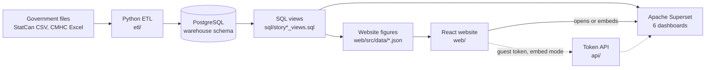
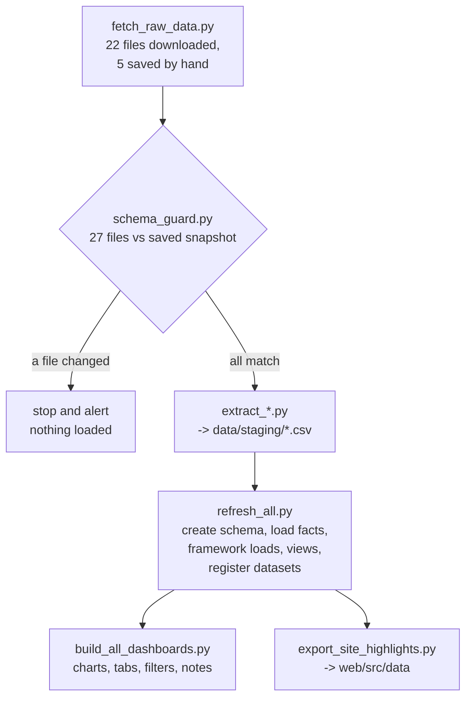

# Architecture

How the Windsor Housing Visual Analytics system is put together: the parts, how data flows through them, where each runs, and which file to open for each job. For the database layers in detail see [data_architecture.md](data_architecture.md); for every table and view, [data_dictionary.md](data_dictionary.md); for the reasons behind the choices, [decision_log.md](decision_log.md).

## 1. The parts



| Part | What it does | Where the code is |
|---|---|---|
| **Sources** | The government files, kept exactly as downloaded | `data/raw/` (not in git; `etl/fetch_raw_data.py` downloads them) |
| **ETL** | Checks each file's structure, reshapes it to long format, validates it, loads the warehouse | `etl/extract_*.py`, `etl/load_warehouse_facts.py`, `etl/schema_guard.py`, `etl/scheduled_refresh.py` |
| **Warehouse** | A star schema: shared dimensions (period, zone, tenure, income band, bedroom type, dwelling type, household type, geography) and 9 fact tables | `sql/warehouse_schema.sql` |
| **SQL views** | Every measure, defined once (59 views, one file per story) | `sql/story1_views.sql` ... `sql/story5_views.sql`, `sql/dashboard1_views.sql` |
| **Superset** | Six dashboards (Overview and Stories 1-5), split into tabs that each fit one screen, with filters and cross-filters | built by `etl/build_*_dashboard.py` and `etl/finalize_story1_layout.py`; never edited by hand |
| **Website** | The public site: each story's question, narrative, key findings drawn by the site itself, and its dashboard | `web/src/pages/`, `web/src/components/` |
| **Website figures** | Every number on the site, exported from the same views as the dashboards | `etl/export_site_highlights.py`, `etl/site_figures.py` -> `web/src/data/` |
| **Token API** | Gives the website short-lived Superset guest tokens to embed dashboards (only used where embedding is allowed) | `api/guest_token_server.py` |

**Why the website and the dashboards always agree:** both read the same SQL views. The dashboards query them live; the website's figures are exported from them at build time, and the export fails a test if newer data has arrived without the page text being reviewed (decision D45).

## 2. Data flow



`etl/scheduled_refresh.py` runs the top three boxes and `refresh_all.py` as one command (weekly on a schedule); the dashboards and the website figures are rebuilt after it. Each step is safe to re-run.

**What happens when something goes wrong:** the schema guard stops the run before anything is read if a source file's columns, sheets or header rows change; each extract checks its own output (cities present, parts add up to totals); the load is re-validated (`docs/data_quality_report.md`). A failed run writes `logs/refresh_alerts.log` (and a Teams/Slack message if `ALERT_WEBHOOK_URL` is set) and leaves the last good data in place.

## 3. Where it runs

```mermaid
flowchart TB
    subgraph Laptop[Team laptop: development]
        L1[Docker Compose:<br/>PostgreSQL 16, Superset 3.1, Redis]
        L2[Vite dev server :5173]
        L3[ETL scripts]
    end
    subgraph UWindsor[University of Windsor: production, on campus or VPN]
        P[(PostgreSQL 15<br/>psql.cs.uwindsor.ca, db whva)]
        A[Superset 6<br/>apss.cs.uwindsor.ca]
        W[whva.cs.uwindsor.ca<br/>nginx: website, backups, uptime check]
    end
    L3 -- export_for_shared_db.py package,<br/>copied to whva and loaded there --> P
    L3 -- build_all_dashboards.py --env .env.apss --> A
    A --> P
    L2 -- npm run build, copied to whva --> W
```

| | Development (laptop) | Production (university) |
|---|---|---|
| Database | PostgreSQL 16 in Docker, `housing_windsor` | PostgreSQL 15, `whva` on `psql.cs.uwindsor.ca`, schema `warehouse` |
| Dashboards | Superset 3.1 in Docker, <http://localhost:8088> | Superset 6, <https://apss.cs.uwindsor.ca> (UWindsor login) |
| Website | <http://localhost:5173> (`npm run dev`) | <https://whva.cs.uwindsor.ca> (nginx, HTTPS) |
| Website mode | embeds dashboards with guest tokens | **link mode**: opens each dashboard on apss, until the admin allows embedding |

The same builder scripts produce both: `etl/superset_compat.py` handles the differences between Superset 3.1 and 6 (`SUPERSET_TARGET=local|shared`). Laptops cannot reach the university database, so data reaches it as one SQL package loaded from whva in a single transaction. Deployment steps: [deploy_university.md](deploy_university.md). Server hardening, backups, uptime monitoring and the restore test: [production_hardening.md](production_hardening.md), section 6.

## 4. The five stories in the code

| Story | Question | Fact tables | Views | Dashboard builder | Web page |
|---|---|---|---|---|---|
| 1 | Who faces the greatest affordability pressure? | `fact_shelter_cost` | `sql/story1_views.sql` | `etl/finalize_story1_layout.py` | `web/src/pages/StoryAffordability.jsx` |
| 2 | What is happening in Windsor's rental market? | `fact_rental_market` | `sql/story2_views.sql` | `etl/build_story2_dashboard.py` | `StoryRentalMarket.jsx` |
| 3 | Is Windsor building enough housing? | `fact_windsor_starts_completions`, `fact_windsor_intended_market` | `sql/story3_views.sql` | `etl/build_story3_dashboard.py` | `StoryHousingSupply.jsx` |
| 4 | How does Windsor compare to similar markets? | `fact_rental_market_comparison`, `fact_peer_cma_context`, `fact_cma_canada` | `sql/story4_views.sql` | `etl/build_story4_dashboard.py` | `StoryComparison.jsx` |
| 5 | Combined Analysis | joins all of the above | `sql/story5_views.sql` | `etl/build_story5_dashboard.py` | `StoryIntegratedAnalysis.jsx` |
| Overview | Key figures from every story | several | `sql/dashboard1_views.sql` | `etl/build_dashboard1_overview.py` | `Home.jsx` |

## 5. Quality checks

| Check | Runs | File |
|---|---|---|
| Schema guard (27 source files) | before every refresh | `etl/schema_guard.py`, snapshot `etl/configs/source_schemas.json` |
| Extract checks | in every extract | `etl/extract_*.py` (`check()`) |
| Load validation | after every load | `etl/validate_rental_market_data.py`, `etl/validate_supply_data.py` -> `docs/data_quality_report.md` |
| Unit tests (115) | every merge to `main`, GitHub Actions | `etl/test_*.py`, `api/test_guest_token_server.py`, `.github/workflows/ci.yml` |
| Web lint and build | every merge | `web/` (`npm run lint`, `npm run build`) |
| Pre-commit hooks | every commit | `.pre-commit-config.yaml` |
