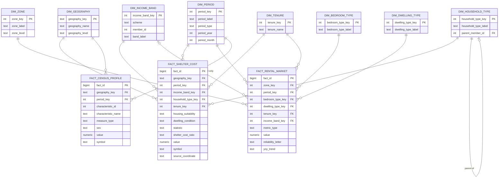

# Conceptual ER Model — Windsor Housing Warehouse

**Scope:** the three sources profiled so far — StatCan 98-10-0252-01 (shelter-cost-to-income ratio), CMHC Windsor RMS 2025, and StatCan 98-401-X2021002 (Census Profile, 2021). The proposal names one more source (CMHC starts/completions) that hasn't been profiled yet — its fact table isn't modeled here, since that would mean guessing a schema for a workbook this team hasn't opened. Add it once it's profiled, following the same pattern.

**Status:** implemented and verified against real Postgres (`sql/warehouse_schema.sql`, `sql/warehouse_seed_dimensions.sql`, run via `etl/create_warehouse_schema.py`) — not just a diagram. **Not yet reviewed with Pavan** — that review hasn't happened; this is ready for that conversation, not a substitute for it.

## Why not all 8 dimensions apply to every fact table

This is a real property of these three surveys, not a gap:

| Dimension | Used by | Why |
|---|---|---|
| `dim_geography` | shelter_cost, census_profile | StatCan's CMA-level, DGUID-based geography |
| `dim_zone` | rental_market only | CMHC's sub-CMA zones — a finer, source-specific grain, not the same thing as `geography` renamed |
| `dim_period` | all three | Different grains (StatCan census year vs. CMHC survey month), unified via `period_type` |
| `dim_tenure` | shelter_cost, rental_market | CMHC RMS is rental-only, so every `fact_rental_market` row is implicitly `tenure = 'Renter'` — still modeled as a real FK for conformance, not hardcoded |
| `dim_income_band` | shelter_cost, rental_market (optional) | StatCan's dollar-bracket scheme and CMHC's income-quintile scheme (Table 3.1.8) are different classifications — one table, a `scheme` column distinguishes them rather than forcing false equivalence |
| `dim_household_type` | shelter_cost only | CMHC RMS has no household-composition dimension |
| `dim_bedroom_type`, `dim_dwelling_type` | rental_market only | StatCan shelter-cost has neither |

`fact_census_profile` uses only `dim_geography` and `dim_period` — both reused as-is from the shelter-cost table (same DGUID `2021S0503559`, same `2021` census-year period, since both are 2021 Census products). It has no FK to `dim_tenure` or `dim_income_band` at all: unlike the other two fact tables, this source's "Owner"/"Renter" and income-bracket breakdowns are each their own `CHARACTERISTIC_ID` row under a parent "Total" characteristic, not a column that varies against a shared dimension — forcing an FK here would mean reverse-engineering a conformance StatCan's own table structure doesn't express. `characteristic_id`/`characteristic_name` are kept as local (degenerate) attributes instead, same treatment as `housing_suitability`/`dwelling_condition` on `fact_shelter_cost`.

**One naming trap avoided:** StatCan's "Dwelling condition" (needs repair, yes/no) is *not* the same concept as `dim_dwelling_type` (Apartment / Row / Combined, from CMHC) despite the similar name. Dwelling condition stays a local text attribute on `fact_shelter_cost`; it was never a candidate for the shared dimension.

## ER Diagram

## Fact table grains

- **`fact_shelter_cost`** — one row per (geography × period × income_band × household_type × housing_suitability × dwelling_condition × statistic × shelter_cost_ratio × tenure) combination. `housing_suitability`, `dwelling_condition`, `statistic`, `shelter_cost_ratio` are degenerate dimensions (local text columns) — none are among this task's 8 listed shared dimensions, so they aren't broken out into their own tables.
- **`fact_rental_market`** — one row per (zone × period × bedroom_type × dwelling_type × tenure × metric_type) combination, with `income_band_key` nullable (populated only for `metric_type` in `quintile_universe`/`quintile_vacancy_rate`, from Table 3.1.8). `metric_type` unifies CMHC's several metric tables into one fact table (per the task's "one fact table per source" instruction) rather than one fact table per sheet: `vacancy_rate`, `average_rent`, `universe`, `turnover_rate` (standard zone × bedroom-type tables); `new_stock_universe`/`new_stock_vacancy_rate`/`new_stock_average_rent` (Table 3.1.7, stock completed July 2022-June 2025, single snapshot); `rent_vacant_units`/`rent_occupied_units` (Table 3.1.9, single snapshot); `quintile_universe`/`quintile_vacancy_rate` (Table 3.1.8). For the three single-snapshot sources (3.1.7, 3.1.8, 3.1.9 — none compare Oct-24 to Oct-25), `period_key` is fixed to `Oct-25`, the edition's current survey date. `yoy_trend` is repurposed for Table 3.1.9's Y/N significance flag (comparing vacant- vs occupied-unit rent, not year-over-year) — both are a short "how do these two values compare" signal, just from different kinds of comparison.
- **`fact_census_profile`** — one row per (geography × period × characteristic_id × measure_type × sex) combination. `characteristic_id`/`characteristic_name` are degenerate dimensions (`etl/extract_windsor_census_profile.py` narrows the source's full 2,631-characteristic set down to a curated 60 covering population, income, tenure, and shelter cost). `measure_type` ('count' | 'rate') and `sex` ('total' | 'men' | 'women') come from `etl/reshape_census_profile_long.py` melting the source's 6 value/symbol column pairs into rows — most characteristics only populate `sex = 'total'` (household-level stats like income or tenure have no sex breakdown), reflected as a null `value` + symbol `'...'` row rather than being dropped.

## What's seeded vs. what's still pending

**Seeded** (real category values from `docs/shelter_cost_audit.md` and `docs/cmhc_rms_sheet_catalogue.md`, not invented):
- `dim_geography`: Windsor CMA (the only geography this project has actually extracted so far)
- `dim_period`: 2021 census year, Oct-24 and Oct-25 CMHC survey periods
- `dim_tenure`: Total, Owner, Renter
- `dim_income_band`: 14 StatCan brackets + 7 CMHC quintile-scheme members (N/A, Q1-Q5, Total) (21 rows). Q5 was missing from the original seed (only N/A-Q4 existed) — fixed here while adding Table 3.1.8's extraction, since that table's data surfaced the gap.
- `dim_household_type`: all 16 real StatCan categories, with `parent_member_id` preserving the hierarchy — this is also where the household-type label collision documented in the audit note lives (member 5 and 10 both render as "Without children" under different parent branches; the surrogate key disambiguates them even though the label alone doesn't). Verified by querying both collision pairs back out with their parent labels.
- `dim_bedroom_type`: Studio, 1BR, 2BR, 3BR+, Total
- `dim_zone`: all 7 real zones + 2 published aggregates
- `dim_dwelling_type`: Apartment, Row (Townhouse), Combined

**Populated for real**, via `etl/load_warehouse_facts.py` (not just a smoke test anymore):
- `fact_shelter_cost`: 90,720 rows, 0 unmatched dimension keys.
- `fact_census_profile`: 360 rows, 0 unmatched dimension keys.
- `fact_rental_market`: 1,395 rows (9 of the RMS workbook's 29 sheets — see `docs/cmhc_rms_sheet_catalogue.md`'s "Open items" for exactly which), 0 unmatched dimension keys, including the Table 3.1.8 income-quintile bridge resolving through `dim_income_band`'s `cmhc_quintile` scheme.

Independently re-queried (not just trusted from load counts) against the live data: Owner households spending 30%+ on shelter costs = 13,005; Windsor population, 2021 = 422,630; Windsor CMA combined vacancy rate (Total bedroom type, Oct-25) = 3.6%. That last number corrects an earlier claim in this doc of "5.9%" from before real data was loaded — 5.9% was actually the *Studio* bedroom type's Oct-25 rate for Windsor CMA, not Total; the smoke test that produced it wasn't checking against a real query, just a single rolled-back insert.

**Pending:**
- Review with Pavan — not done yet.
- The other 20 RMS sheets (Table 1.4 and everything the catalogue's recommendation excluded), and the CMHC starts/completions source (extracted into `data/staging/ontario_canada_starts_completions.csv` but has no fact table yet — see `etl/extract_cmhc_starts_completions.py`).

## Files

- `sql/warehouse_schema.sql` — dimension + fact table DDL
- `sql/warehouse_seed_dimensions.sql` — real dimension member data
- `etl/create_warehouse_schema.py` — creates and seeds the schema (safe to re-run — drops `warehouse` schema first)
