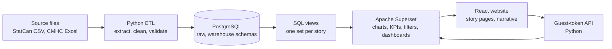
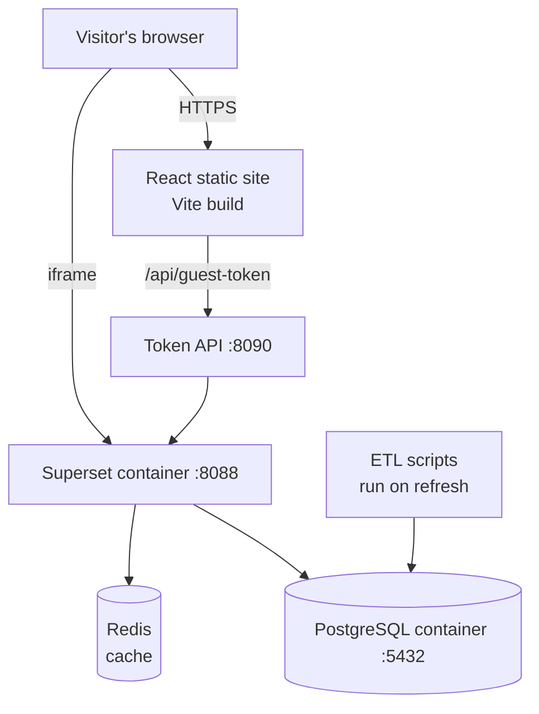
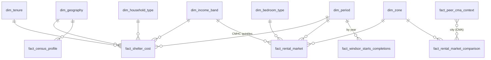
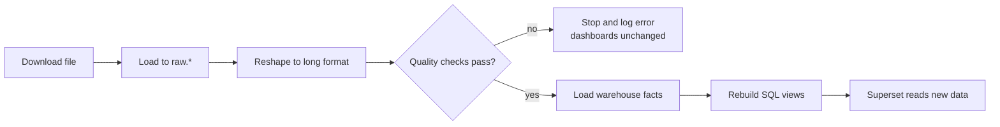

# Design Document: Windsor Housing Visual Analytics

**Course:** COMP-8977 Internship/Project-2, Fall 2026
**Team 1:** Dhritiben Patel (Project Manager), Romit Patel (Data Engineering), Pavan Rella (Analytics), Charmiben Patel (Front-end and Deployment)
**Supervisor:** Dr. Andreas Maniatis | **Course Instructor:** Dr. Prashanth C. Ranga
**Status:** Version 2 (6 November 2026). The current system is a **functional prototype**. Version 1 set out the design and the plan for combining the stories; version 2 records what was built: Story 5 now answers six combined questions (section 7).

---

## 1. Introduction and Context

### 1.1 The problem

In Windsor, housing affordability can't be understood from one number. It depends on how household **income**, **tenure** (renting or owning), **rents**, **vacancy**, and **new housing supply** relate to each other. The data for these comes from two agencies in different formats and different years:

- Statistics Canada: the 2021 Census.
- CMHC: the 2025 rental survey and 2025–26 construction data.

We are building a free, public, web-based tool. It lets anyone see who is under housing pressure in Windsor, and whether the market and new supply meet their needs.

### 1.2 Scope

| In scope | Out of scope |
|---|---|
| Windsor CMA, its 7 CMHC rental zones, and 4 similar Ontario CMAs for comparison | Other provinces, or neighbourhood-level (postal code) data |
| Official open data only (StatCan, CMHC) | Scraped listings such as Kijiji or Facebook |
| Batch refresh when agencies publish new files | Real-time data |
| Descriptive analytics: KPIs, charts, filters, written findings | AI, chatbots, or price prediction |
| Public read-only website plus dashboards | User accounts, or editing data from the website |

### 1.3 Link to the user stories

From the proposal (section 4.3):

| Story | Question | Main dataset(s) |
|---|---|---|
| 1 | Who faces the greatest affordability pressure? | StatCan 98-10-0252-01 (shelter cost by income and tenure) |
| 2 | What is happening in Windsor's rental market? | CMHC Rental Market Survey, Windsor 2025 |
| 3 | Is Windsor building enough housing? | CMHC starts and completions (StatCan 34-10-0154-01) |
| 4 | How does Windsor compare with similar cities? | CMHC Rental Market Survey, Canada 2025 |
| 5 | **How do affordability, rent, and supply fit together?** | **Joins the datasets above, plus the Census Profile (98-401-X2021002) and housing indicators by age (98-10-0241-01), for Windsor and the 4 comparison cities (section 7)** |

**Supervisor feedback (Nov 2026).** Stories 1–4 each use their own file, so the work looked like four separate pieces, and Story 5 only placed one chart from each story side by side. Story 5 has been rebuilt so that its questions **can only be answered by joining datasets**, and each of Stories 1–4 now ends with a "How this connects" box that links to it. That integration is the team's shared work.

---

## 2. Goals and Non-Goals

### 2.1 Goals and success criteria

| # | Goal | How we measure it |
|---|---|---|
| G1 | A visitor can follow each story from question to evidence to conclusion | In user testing, 4 of 5 testers can state each story's main finding in one sentence |
| G2 | At least two **combined questions** use two or more datasets each | Story 5 has 2 or more charts built on SQL views that join different fact tables. **Met:** six combined views (section 7). |
| G3 | Every number can be traced to its source | Every KPI and chart names its source table. Data-quality checks pass on each refresh. |
| G4 | Pages are fast enough | React page loads in under 3 s. Each dashboard chart loads in under 5 s on the hosted server. |
| G5 | Refresh is repeatable | One command (`etl/refresh_all.py`) rebuilds the warehouse from new files with no manual edits |
| G6 | Free to run | Total hosting cost is $0 for the project period |
| G7 | Works on desktop and mobile | Pages are usable at 375 px width with no horizontal scrolling |

### 2.2 Non-goals

- We will not predict future rents or prices.
- We will not join datasets in ways the data doesn't support. For example, there is no zone-level income in the Census table, so we won't invent one.
- We will not build a login system or an admin panel.
- We will not replace official reports. The tool explains them and links back to them.

---

## 3. System Architecture

### 3.1 Logical architecture (what the parts do)



| Layer | Responsibility |
|---|---|
| Sources | Original government downloads, kept unchanged in `data/raw` |
| ETL (Python) | Read the files, reshape them to long format, check data quality, and load the warehouse |
| Database | `raw` schema holds the files as they arrived. `warehouse` schema is a star schema of dimensions and facts. |
| SQL views | Each story's measures, defined once, for example `v_story1_burden_by_tenure` |
| Superset | Turns the views into charts and dashboards with native filters |
| React | The public website: story text, KPIs, and embedded dashboards |
| Guest-token API | Issues short-lived tokens so React can embed private dashboards safely |

### 3.2 Physical architecture (where it runs)



- **Now (prototype):** Docker Compose on a laptop runs Postgres, Superset and Redis. Vite serves React on port 5173.
- **Deployment target (late Nov):** Render. React as a static site, Superset as a web service, and a Postgres instance. See `docs/hosting_decision.md`.

---

## 4. Data Model

### 4.1 Star schema (simplified ERD)



| Table | Grain (one row is…) | Used by |
|---|---|---|
| `fact_shelter_cost` | Households for one income band × tenure × household type × shelter-cost ratio (2021) | Story 1 |
| `fact_rental_market` | One rent, vacancy, universe or turnover value for zone × bedroom type × year | Story 2 |
| `fact_windsor_starts_completions` | Units started or completed in one month × dwelling type | Story 3 |
| `fact_rental_market_comparison` | One rental metric for a CMA × bedroom type × year | Story 4 |
| `fact_census_profile` | One Census characteristic (population, households…) for Windsor | Context, Story 3 |
| `fact_peer_cma_context` | One figure for Windsor or a comparison CMA: renter income band, Census population or households, or a year's starts or completions | Story 5 |

**Shared dimensions are what let us combine stories.** `dim_tenure`, `dim_income_band`, `dim_period`, and the Windsor CMA geography appear in more than one fact table. The comparison cities link through their CMA name and code. Section 7 uses these links.

The full ERD is in `docs/warehouse_er_diagram.md`.

### 4.2 Data flow



---

## 5. Component Design

### 5.1 ETL refresh (`etl/refresh_all.py`)

```
for each source in [shelter_cost, census_profile, rms_windsor, rms_canada, starts]:
    file = download_or_read(source)
    df   = reshape_to_long(file)
    errors = validate(df)   # row counts, required columns, no duplicate keys,
                            # values in range, StatCan symbols mapped to flags
    if errors: log(errors); stop          # never load half-checked data
recreate warehouse schema and dimensions
load all facts
apply story SQL views (sql/*.sql)
```

### 5.2 Story measures (SQL views)

- **Shelter-cost burden %** = households spending 30% or more ÷ all households, per tenure and income band.
- **Required income for a rent (new, for Story 5)** = `average_rent × 12 ÷ 0.30`. This is the income at which that rent equals 30% of income, the national affordability line.
- **Affordable share of renters (new, for Story 5)** = renter households with income at or above the required income ÷ all renter households.
- **Starts per 1,000 households** = annual starts ÷ (2021 households ÷ 1,000).
- **Homes needed for population growth (Story 5)** = (2021 population − 2016 population) ÷ people per household (2021).

### 5.3 Guest-token API (`api/guest_token_server.py`)

```
POST /api/guest-token   body: {"dashboard": "story1"}
    if Origin is not the website: return 403   # also 415 non-JSON, 413 too large,
                                               # 429 over 30 requests a minute
    if dashboard not in allow-list: return 404
    log in to Superset as service account (credentials from .env)
    token = POST /api/v1/security/guest_token/ {dashboard uuid, read-only}
    return {token}          # expires after a short time; React SDK refreshes it
```

### 5.4 React story page (`web/src/components/StoryPage.jsx`)

Every story uses one shared component:

```
StoryPage(title, questions, kpis, dashboard, narrative, connections, limitations, source)
  -> header, then KPI row, then embedded dashboard, then narrative,
     then "How this connects" (Stories 1-4, links to Story 5), then limitations, then source line
```

---

## 6. Interface Design

### 6.1 Screen layout (every story page)

```
+--------------------------------------------------------------+
|  LOGO   Home  Story1  Story2  Story3  Story4  Story5  About  |
+--------------------------------------------------------------+
|  01  Story 1                                                 |
|      Who faces the greatest affordability pressure?          |
|      - question 1   - question 2                             |
+--------------------------------------------------------------+
|  Filters: Geography [Windsor CMA]  Year [2021]               |
+--------------+--------------+--------------+-----------------+
|  KPI  55%    |  KPI  34.8%  |  KPI  10.9%  |  KPI  $48,400   |
+--------------+--------------+--------------+-----------------+
|                                                              |
|          Embedded Superset dashboard (full width)            |
|                                                              |
+--------------------------------------------------------------+
|  What this shows (2-3 short paragraphs)                      |
|  Known limitations  |  Source: StatCan 98-10-0252-01         |
+--------------------------------------------------------------+
```

On mobile, KPI tiles stack in two columns and the dashboard scrolls inside its own frame.

### 6.2 Story 5 layout (as built)

```
+--------------------------------------------------------------+
| Story 5: How do affordability, rent, and supply fit together?|
+--------------+--------------+--------------+-----------------+
| KPI 61%      | KPI 36%      | KPI 5,247    | KPI 8.4         |
| can't afford | 2-bed rent / | completed    | starts per      |
| a 2-bed      | income       | 2023-2025    | 1,000 households|
+--------------+--------------+--------------+-----------------+
| 1. Can renters afford the rent?   bars by unit size + table  |
| 2. Affordable, or only cheap?     bars by city + table       |
| 3. Did new homes ease the market? completions | vacancy      |
| 4. Building as much as peers?     bars by city | trend       |
| 5. Keeping up with population?    % of needed | needed vs    |
|                                   homes built | built        |
| 6. Can young renters afford it?   by city | Windsor by age  |
|  each section ends with a note that states the finding       |
+--------------------------------------------------------------+
| Filter: Years (sections 3 and 4)                             |
+--------------------------------------------------------------+
```

Windsor is blue and the comparison cities grey in every chart. Comparisons use bars and change over time uses lines, chosen once the data was ready (section 8.3).

We choose chart types **after** the data for each question is ready, using the rules in section 8.3. We don't fix pie or bar charts in advance.

### 6.3 API

| Endpoint | Method | Input | Output |
|---|---|---|---|
| `/api/guest-token` | POST | JSON body `{"dashboard": "..."}` (allow-listed name) | `{ "token": "..." }`, or 404 or 502 |
| Superset `/superset/dashboard/{id}/` | GET | Dashboard id | Public read-only dashboard |

---

## 7. Integrating the Stories (answer to the supervisor's main question)

**The question:** can the datasets be combined to answer questions none of them can answer alone?
**Answer:** yes, through the shared keys: the renter (tenure and income), the city (CMA) and the year. Story 5 is built on six SQL views (`sql/story5_views.sql`), each joining at least two sources.

| Combined question | Datasets joined | Join key | Result |
|---|---|---|---|
| **Q1. Can Windsor renters afford the average rent?** | Story 1 (renter income bands) + Story 2 (rent by unit size) | Windsor CMA + renter | **61%** of renter households can't afford an average 2-bedroom; about half can't afford a 1-bedroom |
| **Q2. Is Windsor affordable, or only cheap?** | Story 1 (renter incomes and burden, all 5 cities) + Story 4 (2-bedroom rents) | CMA | Lowest rent, but second-lowest renter incomes: rent takes **36%** of the median renter's income, the same as Hamilton |
| **Q3. Did new homes ease the rental market?** | Story 3 (completions) + Story 2 (vacancy, rent increase) | Windsor CMA + year | Vacancy fell to **1.8%** in 2022 when few homes were finished, then rose to **3.6%** after the 2023 completion surge |
| **Q4. Is Windsor building as much as its peers?** | Story 3 (starts, all 5 cities) + Story 4 (comparison cities) + Census households | CMA + year | **8.4** starts a year per 1,000 households, the fewest of the five |
| **Q5. Did building keep up with population growth?** | Story 3 (completions, all 5 cities) + Census population 2016 and 2021 | CMA | Windsor completed **59%** of the homes its growth needed, the lowest of the five (72%–91% elsewhere) |
| **Q6. Can young renters and students afford to rent?** | Census renters by age (98-10-0241-01, new) + Story 1 (burden measure) + Story 4 (comparison cities) | CMA + renter + age | **46.5%** of Windsor renter households aged 15–24 spend 30%+ on shelter, against 34.8% of all renters: the most burdened age group, though less than in the other cities (51%–55%) |

**Only one new download.** Version 1 expected a 5th dataset for the comparison cities' incomes. The Census and StatCan files we already used for Windsor cover every CMA, so `etl/extract_peer_cma_context.py` takes the four comparison cities' rows from them. The student question (Q6) needed one new Census table, 98-10-0241-01 (housing indicators by age of the household maintainer). It counts students who head their own rented household, not those in residence or living with parents.

### 7.1 Worked example for Q1

- Average 2-bedroom rent in Windsor CMA, Oct 2025 (apartments and row houses): **$1,451**. Required income at 30% = 1,451 × 12 ÷ 0.30 = **$58,040**.
- Median renter household income in Windsor (2021 Census): **$48,400**.
- Renter incomes come in $10,000 bands. Bands entirely below $58,040 count in full; for the $50,000–$59,999 band, households are assumed to be spread evenly across it.
- Result: **27,664 of 45,605 renter households (61%)** earn less than the average 2-bedroom needs.

**Finding:** most Windsor renters can't afford the average 2-bedroom under the 30% rule, even though Windsor has the lowest rent of its peer cities. Neither dataset could show this alone.

**Caveat:** incomes are from the 2021 Census (2020 incomes) and rents from 2025. We label the gap on the page and treat the shares as an upper bound, since incomes have risen since.

**Cross-check from CMHC's own data:** CMHC Table 3.1.8 (already loaded) groups Windsor's 19,883 rental units by which renter income quintile can afford them. Only **4,482 (23%)** are affordable to the lowest-income fifth (Q1). This confirms Q1 using a second, independent source.

### 7.2 What was built, and what is left

**Built:** the six combined views, including the student question; the Story 5 dashboard with a Years filter, embedded on the website; the Story 5 page; and the "How this connects" boxes on Stories 1–4. Method, findings and limitations are in `docs/story5_combined_analysis.md`.

**Left for later:**
1. **Neighbourhood level.** Joining Census areas to CMHC rental zones would show which zones are least affordable for local residents. It needs a Census-area-to-zone mapping.
2. **Affordability gap (Story 4).** Rent growth minus income growth needs a second year of income, for example from the 2016 Census.

---

## 8. Constraints, Security, and Design Rationale

### 8.1 Constraints

| Constraint | Effect | How we handle it |
|---|---|---|
| Free hosting is small (about 512 MB RAM) and sleeps when idle | Superset is heavy, so the first load is slow | Redis cache, fewer charts per dashboard, warm-up request before demos |
| Sources come from different years (2021, 2025, 2026) | Joins can mislead | Join only on matching geography; label every year; document the rules |
| CMHC suppresses small values (shown as `**`) | Some zone and bedroom cells are empty | Keep a data-quality flag, show "not available", never fill in values |
| Census data stops at the CMA level | No zone-level income | Combined questions stay at CMA level |

### 8.2 Security

- Dashboards are **read-only**. The Public role can see only listed datasets (`PUBLIC_DATASOURCE_NAMES`).
- Passwords and keys live in `.env`, which is not committed. `.env.example` lists the names only.
- Guest tokens are short-lived, allow-listed per dashboard, and limited to the website's domain (`allowed_domains`).
- The data is public government data with no personal information.
- The ETL validation step stops bad files from reaching the dashboards.

### 8.3 Design rationale

| Choice | Why |
|---|---|
| **PostgreSQL** | Free, reliable SQL. Views keep each measure defined once. Superset connects natively. |
| **Star schema** | Shared dimensions such as tenure, income and period make cross-story joins (section 7) simple and correct |
| **Python (pandas)** | Reads StatCan CSV and multi-sheet CMHC Excel files. The team already knows it. Scripts are repeatable. |
| **Apache Superset** | Free, open source and web-based. The supervisor asked for an alternative to Power BI. Supports embedding and filters. |
| **React (Vite)** | Lets us write the story text around the dashboards, which a BI tool alone can't do well. Builds to a free static site. |
| **Docker** | Every team member runs the same Postgres, Superset and Redis setup |
| **Render** | Oracle Free Tier signup failed twice. Render is free and simple (`docs/hosting_decision.md`). |
| **Chart choice rule** | Pick by what the data does. Comparing amounts uses bars. Change over time uses lines. Parts of a whole with few groups can use a donut. A single headline number uses a KPI tile. We choose after the data is ready, not before. |

---

## 9. Summary of Supervisor Questions

| Supervisor's question | Where it's answered |
|---|---|
| "Where is the design? You should design before implementing." | This document. The current build is the prototype for this design. |
| "Four people, four files: where is the teamwork?" | Section 7: six combined questions, built in Story 5; Stories 1–4 each link to it |
| "Can we find a common element between the files?" | Section 4.1 (shared dimensions) and the join-key column in section 7 |
| "Do we need a 5th dataset?" | Not for the comparison cities: the files we have cover every CMA. The student question added one Census table, 98-10-0241-01 (section 7). |
| "Can students afford these houses?" | Q6 in section 7: young renter households (15–24) are the most burdened age group in Windsor |
| "Don't decide pie or bar before the design" | Sections 6.2 and 8.3: charts are chosen after the data is ready |
| "Next week: combine at least two files" | Done: six combined views (section 7) |
