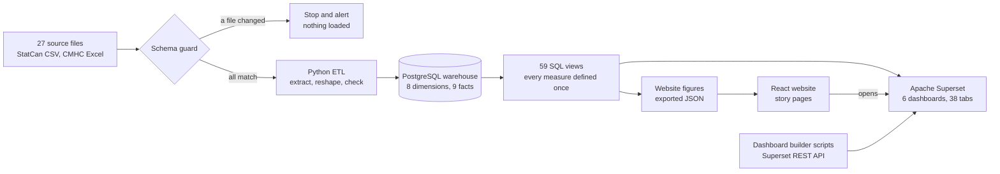
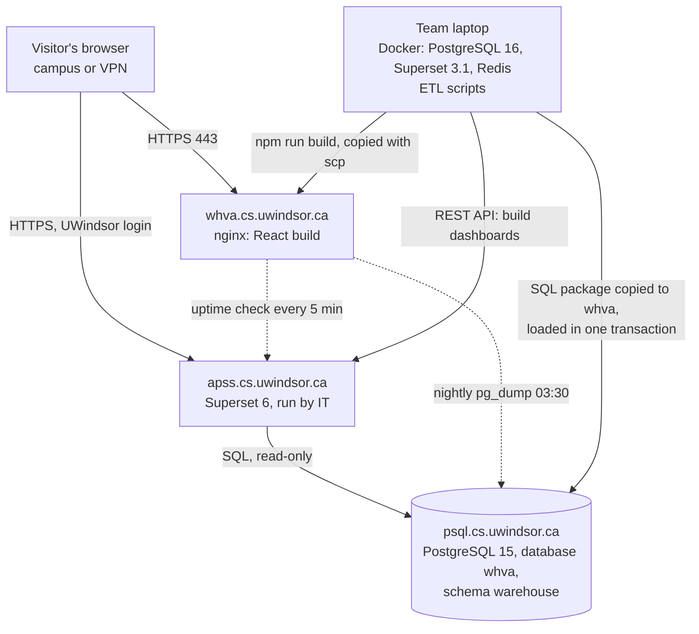
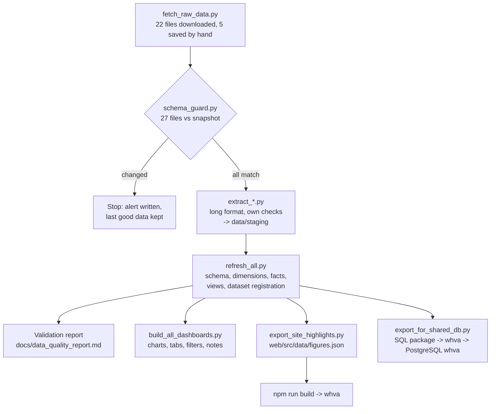

# Design Document: Windsor Housing Visual Analytics

**Course:** COMP-8977 Internship/Project-2, Fall 2026
**Team 1:** Dhritiben Patel (Project Manager and Data Analysis Lead), Romit Patel (Data Engineering Lead), Pavan Rella (Analytics and Visualisation Lead), Charmiben Patel (Front-end and Deployment Lead)
**Supervisor:** Dr. Andreas Maniatis | **Course Instructor:** Dr. Prashanth C. Ranga
**Status:** Version 3, final (25 November 2026).

The three versions:
- **Version 1** set out the design.
- **Version 2** (6 November) described the working prototype.
- **Version 3** describes the system as deployed on the University of Windsor's servers:
  - **Website:** <https://whva.cs.uwindsor.ca>
  - **Dashboards:** <https://apss.cs.uwindsor.ca>

Both are reachable on campus or through the VPN.

---

## 1. Introduction and Context

### 1.1 The problem

In Windsor, housing affordability can't be understood from one number. It depends on how five things relate to each other:
- household **income**;
- **tenure** (renting or owning);
- **rents**;
- **vacancy**;
- **new housing supply**.

The data for these comes from two agencies, in different formats, on different schedules:

| Source | What it publishes | How often |
|---|---|---|
| **Statistics Canada** | Census incomes and shelter costs | Every five years; the latest is the 2021 Census, which reports 2020 incomes |
| **Statistics Canada** | Monthly construction tables | Monthly |
| **CMHC** | Rental Market Survey | Every October |
| **CMHC** | Starts and completions | Monthly |

Nobody had put these side by side for Windsor in a form the public can use.

We built a free, public, web-based tool. It shows who is under housing pressure in Windsor, what is happening to rents and supply, how Windsor compares with similar cities, and how these fit together.

### 1.2 Scope

| In scope | Out of scope |
|---|---|
| Windsor CMA, its 7 CMHC rental zones, 4 similar Ontario CMAs (London, Hamilton, Kitchener-Cambridge-Waterloo, St. Catharines-Niagara), Toronto as a reference line, and 32 Canadian CMAs for one national comparison | Other provinces in detail; neighbourhood or postal-code data |
| Official open data only: Statistics Canada and CMHC (27 source files) | Scraped listings such as Kijiji or Facebook Marketplace |
| Batch refresh when the agencies publish new files (weekly scheduled check) | Real-time data |
| Descriptive analytics: KPIs, charts, filters, written findings, clearly labelled scenarios | AI, chatbots, price prediction or forecasting |
| A public read-only website plus six interactive dashboards | User accounts, or editing data from the website |

### 1.3 Link to the user stories

The user stories come from the proposal (section 4.3). Each one became a dashboard and a website page.

| Story | Question | Main dataset(s) |
|---|---|---|
| 1 | Who faces the greatest affordability pressure? | StatCan 98-10-0252-01: shelter cost by income and tenure, Census 2021 |
| 2 | What is happening in Windsor's rental market? | CMHC Rental Market Survey, Windsor, 2021–2025 (by zone and unit size) |
| 3 | Is Windsor building enough housing? | CMHC starts and completions, through StatCan 34-10-0154-01 (monthly); CMHC Housing Market Information Portal (intended market) |
| 4 | How does Windsor compare with similar markets? | CMHC Rental Market Survey, Canada, 2019–2025; StatCan 34-10-0133-01 and 34-10-0130-01 (2015–2025 rents and vacancy) |
| 5 | **Combined Analysis:** how do affordability, rental conditions and supply fit together? | Joins all of the above, plus the Census Profile (98-401-X2021002), housing indicators by age (98-10-0241-01) and each comparison city's CMHC workbook (section 7) |
| Overview | The key figure from each story on one page | Several |

**Supervisor feedback, November 2026.** Stories 1–4 each used their own file, so the work looked like four separate pieces. The supervisor asked us to combine the datasets. Story 5 was rebuilt so that each of its eight questions **can only be answered by joining datasets**, and it was renamed "Combined Analysis". The supervisor also asked that each dashboard tab fit on one screen; all 38 tabs now do.

---

## 2. Goals and Non-Goals

### 2.1 Goals and success criteria

| # | Goal | Success criterion | Result (November 2026) |
|---|---|---|---|
| G1 | A visitor can follow each story from question to evidence to conclusion | In user testing, 4 of 5 testers can state each story's main finding in one sentence | Sessions planned (`docs/user_testing_plan.md`) |
| G2 | At least two **combined questions**, each using two or more datasets | Story 5 has at least 2 charts built on SQL views that join different fact tables | **Met:** 8 combined questions on 11 Story 5 views |
| G3 | Every number can be traced to its source | Every chart names its source table; data checks pass on each refresh; computed rates match published ones | **Met:** schema guard on 27 files; Story 1 rates match Statistics Canada's published 34.8% and 10.9% exactly (difference 0.0) |
| G4 | Pages are fast enough | Website page in under 3 s; each dashboard chart in under 5 s | **Met:** median page load under 0.1 s with up to 10 visitors at once, and no errors up to 25 (`docs/load_test_results.md`) |
| G5 | Refresh is repeatable | One command rebuilds the warehouse from new files with no manual edits | **Met:** `etl/scheduled_refresh.py` (download, check, extract, load, views) |
| G6 | Free to run | $0 hosting for the project period | **Met:** the university's servers |
| G7 | Works on desktop, mobile and for everyone | No horizontal scrolling at 320–414 px; no automated accessibility violations | **Met:** 0 axe violations (WCAG 2.1 A/AA) on all 8 pages at 1440 px and 375 px |
| G8 | Dashboards are easy to read | Every dashboard tab fits one 1440 × 1000 screen and every filter works | **Met:** all 38 tabs checked on the university's Superset |
| G9 | The service stays available and recoverable | Daily backup that can be restored; outages detected | **Met:** nightly backup (restore test passed: 18 tables, 59 views), uptime check every 5 minutes |

### 2.2 Non-goals

- **No predictions of future rents or prices.** The Windsor 2030 tab shows labelled scenarios with stated assumptions, not forecasts.
- **No joins the data doesn't support.** For example, the Census has no zone-level income, so we don't invent one.
- **No login system or admin panel** on the website.
- **No replacing official reports.** The tool explains them and links back to them.

---

## 3. System Architecture

### 3.1 Logical architecture: what the parts do



| Layer | Responsibility | Code |
|---|---|---|
| Sources | The original government downloads, kept unchanged | `data/raw/` (not in git); `etl/fetch_raw_data.py` |
| Schema guard | Compares each file's columns, sheets and header rows with a saved snapshot, and stops the run if anything changed | `etl/schema_guard.py`, `etl/configs/source_schemas.json` |
| ETL | Reads each file, reshapes it to long format (one value per row), checks totals and coverage, and loads the warehouse | `etl/extract_*.py`, `etl/load_warehouse_facts.py`, `etl/refresh_all.py` |
| Warehouse | A star schema: shared dimensions plus fact tables | `sql/warehouse_schema.sql` |
| SQL views | Every measure, defined once | `sql/story1_views.sql` … `sql/story5_views.sql`, `sql/dashboard1_views.sql` |
| Dashboards | Charts, KPIs, tabs and filters, created by scripts through Superset's REST API, never by hand | `etl/build_*_dashboard.py`, `etl/superset_compat.py`, `etl/dashboard_tabs.py` |
| Website figures | Every number on the website, exported from the same views | `etl/export_site_highlights.py` → `web/src/data/*.json` |
| Website | The public story site: question, narrative, key figures, the site's own charts, and a link to each dashboard | `web/src/pages/`, `web/src/components/` |
| Guest-token API | Short-lived tokens for embedding dashboards; used locally, kept ready for the university server | `api/guest_token_server.py` |

**How the parts interact:**
- The **ETL** writes to the database.
- **Superset** only reads views.
- The **website** reads exported JSON at build time and links to Superset.
- Nothing writes back to the data.

Because the dashboards and the website read the **same views**, their numbers always agree.

### 3.2 Physical architecture: where it runs



| | Development (team laptop) | Production (University of Windsor) |
|---|---|---|
| Database | PostgreSQL 16 in Docker | PostgreSQL 15, database `whva` on psql.cs.uwindsor.ca, schema `warehouse` |
| Dashboards | Superset 3.1 in Docker (localhost:8088), with Redis cache | Superset 6 at apss.cs.uwindsor.ca (UWindsor login), run by University IT |
| Website | Vite dev server (localhost:5173) | whva.cs.uwindsor.ca: nginx with the university's certificate |
| Website mode | Embeds dashboards with guest tokens | **Link mode**: each story page opens its dashboard on apss, until embedding is allowed |
| Operations | - | Nightly backup at 03:30 (14 days kept); uptime check every 5 minutes; nftables firewall |

**Two constraints shape the deployment.**
- **Laptops can't reach the database**, even on the VPN; only campus hosts such as whva can. So `etl/export_for_shared_db.py` writes one SQL package, which is copied to whva and loaded there in a single transaction.
- **The two Superset versions differ** (3.1 locally, 6 at the university). The same builder scripts produce both: `SUPERSET_TARGET=local|shared` selects the version-specific settings in `etl/superset_compat.py`.

---

## 4. Data Model

### 4.1 Database layers

| Layer | Holds | Why |
|---|---|---|
| `data/raw` (files) | The downloads exactly as published | Every number can be traced to the original file |
| `data/staging` (CSV) | Each extract's long-format output | Can be inspected and tested before loading |
| `warehouse` schema | Star schema: 8 dimensions, 9 fact tables, 59 views | One clean model that every dashboard and page reads |

### 4.2 Star schema (ERD)

The diagram images are `docs/diagrams/warehouse_er_diagram.png` (full) and `docs/diagrams/star_schema_simplified.png`.

```mermaid
erDiagram
    dim_geography ||--o{ fact_shelter_cost : "CMA"
    dim_income_band ||--o{ fact_shelter_cost : "income band"
    dim_tenure ||--o{ fact_shelter_cost : "renter / owner"
    dim_household_type ||--o{ fact_shelter_cost : "household type"
    dim_period ||--o{ fact_shelter_cost : "Census year"

    dim_zone ||--o{ fact_rental_market : "CMHC zone"
    dim_bedroom_type ||--o{ fact_rental_market : "unit size"
    dim_dwelling_type ||--o{ fact_rental_market : "apartment / row"
    dim_period ||--o{ fact_rental_market : "October survey"
    dim_income_band ||--o{ fact_rental_market : "renter quintile"

    dim_bedroom_type ||--o{ fact_rental_market_comparison : "unit size"
    dim_period ||--o{ fact_rental_market_comparison : "year"
    dim_geography ||--o{ fact_census_profile : "CMA"
    dim_period ||--o{ fact_windsor_starts_completions : "month"
    dim_dwelling_type ||--o{ fact_windsor_starts_completions : "dwelling type"
    dim_period ||--o{ fact_starts_completions : "quarter"
    dim_period ||--o{ fact_cma_canada : "year"
    dim_period ||--o{ fact_peer_cma_context : "year"
```



| Fact table | Grain (one row is…) | Used by |
|---|---|---|
| `fact_shelter_cost` | Households for one income band × tenure × household type × shelter-cost-to-income band (Census 2021) | Story 1, Story 5 |
| `fact_rental_market` | One rent, vacancy, universe or turnover value for zone × unit size × dwelling type × October survey (2020–2025) | Story 2 |
| `fact_rental_market_comparison` | One rental measure for a CMA × unit size × year | Story 4 |
| `fact_cma_canada` | One CMA's apartment vacancy and 2-bedroom rent for a year, from CMHC Table 1.0 (2019–2025) | Stories 2, 4 |
| `fact_census_profile` | One Census characteristic (population, households, …) for a CMA | Stories 3–5 |
| `fact_windsor_starts_completions` | Units started, completed or under construction in one month × dwelling type, Windsor | Story 3 |
| `fact_windsor_intended_market` | Units started or completed for one period × intended market (rental, homeownership, condo, co-op) | Story 3 |
| `fact_starts_completions` | Quarterly starts for Ontario and Canada (context only; the file has no Windsor rows) | Overview |
| `fact_peer_cma_context` | One figure for Windsor or a comparison city: renter households by income band, population, households, yearly starts or completions, rents and vacancy 2015–2025, renters by age | Stories 4, 5 |

**Shared dimensions are what make the stories combinable.** `dim_tenure`, `dim_income_band`, `dim_period` and the CMA (geography) appear in several fact tables, so a renter's income (Story 1) can be joined to a rent (Story 2) or to a city's construction (Story 3) through the city and the year (section 7).

**Views per file:**

| File | Views |
|---|---|
| `story1_views.sql` | 10 |
| `story2_views.sql` | 16 |
| `story3_views.sql` | 10 |
| `story4_views.sql` | 9 |
| `story5_views.sql` | 11 |
| `dashboard1_views.sql` | 3 |
| **Total** | **59** |

### 4.3 Data flow



---

## 5. Component Design

### 5.1 Schema guard (`etl/schema_guard.py`)

```
for each source file in the snapshot:
    if CSV:    structure = header row
    if Excel:  structure = list of sheets + each sheet's title and heading rows
    replace every number in the structure with "#"     # "Oct-25" and "Oct-26" both become "Oct-#"
    if structure != snapshot[file]:
        report the sheet, row and old vs new text
if any file differed: write logs/refresh_alerts.log, exit 1   # nothing is read or loaded
```

Replacing numbers lets a new edition with new years pass, while a renamed, added, removed or reordered column fails.

### 5.2 Extract (`etl/extract_*.py`, one per source)

```
read the file at the fixed sheet and header row
map StatCan / CMHC symbols ("x", "**", "..") to NULL plus a reliability flag   # never fill in values
reshape wide -> long: one row per (geography, period, category..., measure, value)
check(): every expected city / zone / year present; parts add up to totals; values in range
write data/staging/<source>.csv
```

### 5.3 Refresh (`etl/scheduled_refresh.py` → `etl/refresh_all.py`)

```
download the tables that change (StatCan API) -> schema guard -> all extracts
in one run: recreate warehouse schema; seed dimensions; load each fact from staging;
            create the 59 views; register Superset datasets
validate the load (row counts, keys, ranges) -> data quality report
on any failure: alert and stop; the last good warehouse stays in place
```

Every step is safe to re-run. A refresh is then published by rebuilding the dashboards and the website figures.

### 5.4 The measures (SQL views)

| Measure | Formula |
|---|---|
| Shelter-cost burden % | households spending 30%+ of income on shelter ÷ all households with a ratio, per tenure, income band or household type. "Not applicable" households are excluded, as Statistics Canada does. |
| Affordability gap | renter burden − owner burden (23.8 points); ratio = renter ÷ owner (3.18) |
| Required income for a rent | `monthly rent × 12 ÷ 0.30`, the income at which the rent is 30% of income |
| Renters who can't afford a rent | renter households below the required income. Income bands are $10,000 wide: bands entirely below count in full, and the band containing the threshold counts in proportion (households assumed spread evenly across it). |
| Rent as % of median renter income | `2-bed rent × 12 ÷ median renter household income` |
| Rent index | each city's rent ÷ its own 2019 rent × 100 |
| Average yearly rise | `(rent_end ÷ rent_start)^(1/5) − 1` |
| Starts per 1,000 households | yearly starts ÷ (2021 households ÷ 1,000) |
| Homes needed for population growth | `(population 2021 − population 2016) ÷ people per household (2021)`; built share = completions 2016–2020 ÷ homes needed |
| Year-to-date shortfall | `1 − (Jan–Sep this year ÷ Jan–Sep of the earlier year)`, so a partial year is only compared with the same months |

### 5.5 Windsor 2030 scenarios (`v_story5_rent_outlook`)

```
for each city in the 5 cities:
  for rent_pace in [2015-2020 pace, 2020-2025 pace]:
    yearly_rise = (rent_end / rent_start)^(1/5) - 1
    for income_growth in [2%, 3%, 4%]:
      for year in 2025..2030:
        rent      = rent_2025 × (1 + yearly_rise)^(year - 2025)
        needed    = rent × 12 / 0.30
        threshold = needed / (1 + income_growth)^(year - 2020)   # same threshold in 2020 dollars
        priced_out = renter households of 2020 below threshold   # band count as in 5.4
```

The central scenario (2020–2025 rent pace, incomes +3% a year) takes Windsor from **52% to 63%** by 2030. All six scenarios rise, ending between **51% and 68%**. These are scenarios, not forecasts: no year-by-year renter income exists, so income growth is assumed and stated.

### 5.6 Dashboards as code (`etl/build_*_dashboard.py`)

```
log in to Superset (REST: /api/v1/security/login, CSRF token)
for each chart spec (name, dataset, viz type, params):
    find by name -> update, or create                  # re-runs are safe; ids are kept
    superset_compat: adapt params to Superset 3.1 or 6  # sort order, stacking, margins, chart types
build position JSON: headers, rows, chart sizes; add_tabs() puts rows into one-screen tabs
set native filters with explicit scopes (each filter reaches only its own charts)
set colours (Windsor blue, comparison cities grey), slug, theme CSS; publish
```

Since every dashboard is code, moving to the university's Superset 6 was a rebuild in minutes rather than redrawing 100 charts. An example of a version difference handled in code: Superset 6 reserves space for a zoom slider and axis titles, so horizontal bars turn both off (decision D60).

### 5.7 No hand-typed numbers on the website (`etl/export_site_highlights.py`)

```
for each figure the pages use (~100: KPI tiles, narratives, rankings):
    read it from its warehouse view -> web/src/data/figures.json
record the data period the page text was written for
test: fails if newer data has arrived and the page text has not been reviewed
```

### 5.8 Guest-token API (`api/guest_token_server.py`)

```
POST /api/guest-token   {"dashboard": "story1"}
    Origin not the website -> 403;  not JSON -> 415;  body too large -> 413
    more than 30 requests a minute from a client -> 429
    dashboard not in allow-list -> 404
    log in to Superset as the service account (secrets from a root-only env file)
    return a short-lived, read-only guest token for that dashboard only
```

### 5.9 Operations (`deploy/whva/`)

- **Backup**, every night at 03:30 (`backup_whva_warehouse.sh`):
  1. Run `pg_dump` of the `warehouse` schema; the password comes from `~/.pgpass`.
  2. Check that `pg_restore --list` can read the copy; a copy that can't be read is not a backup.
  3. Keep 14 days of copies.
- **Uptime**, every 5 minutes (`uptime_check.sh`):
  1. Request the website and apss's `/health`.
  2. Log UP or DOWN with the response time.
  3. Send one alert when a URL goes down and one when it's back.
  - `--report` prints the availability for each URL.
- **Restore test** (`restore_test.sh`): restore the newest backup into a temporary PostgreSQL server and compare its row counts with the live database. Result on 20 November: PASS, 18 tables and 59 views.

---

## 6. Interface Design

### 6.1 Website: site map and page layout

| Page | Contents |
|---|---|
| Home | The five questions; **"The story in four charts"**: a waffle chart of renters who can't afford a 2-bedroom, rent against renter income with the 30% line, ten years of rent with events marked, homes built per 10 needed. Each chart has a tooltip that also works from the keyboard, a "Show the numbers" table, and a link to its dashboard. Then the team section. |
| Stories 1–5 | One page per story, built from one shared component (`StoryPage.jsx`) |
| Methodology | How each measure is calculated, and the scope of each figure |
| Sources | Every government table used, with links |

Story page layout (desktop; on phones the columns stack):

```
+----------+---------------------------------------------------+
| SIDEBAR  |  Story 2 · Rental market                          |
| Home     |  What is happening in Windsor's rental market?    |
| Story 1  +---------------------------------------------------+
| Story 2  |  Narrative: the answer in plain language          |
| Story 3  +------------+------------+------------+------------+
| Story 4  |  KPI 3.7%  |  KPI $1,454|  KPI +53%  |  KPI 2.3%  |
| Story 5  +------------+------------+------------+------------+
| Method.  |  Key-finding chart drawn by the site              |
| Sources  |  [Show the numbers]                               |
|          +---------------------------------------------------+
| [Hide    |  About this data: apartments, October 2025, CMHC  |
|  menu]   +---------------------------------------------------+
|          |  [ Open the dashboard ↗ ]  (opens apss)           |
|          +---------------------------------------------------+
|          |  How this connects -> Combined Analysis           |
+----------+---------------------------------------------------+
```

The visitor reads first, then explores (decision D54). Accessibility features:
- a skip link and visible focus outlines;
- every chart has its numbers as a table;
- new-tab links announce "(opens in a new tab)";
- the desktop sidebar can be hidden, and the choice is remembered.

### 6.2 Dashboard layout

```
+------------------+------------------------------------------------------+
| Filters          |  Tab 1 | Tab 2 | Tab 3 | ...      (each = one screen)  |
| [Zone       v]   +------------------------------------------------------+
| [Bedroom    v]   |  Section header: the question this tab answers       |
| [Apply filters]  |  +--------+ +--------+ +--------+ +--------+         |
|                  |  |  KPI   | |  KPI   | |  KPI   | |  KPI   |         |
|                  |  +--------+ +--------+ +--------+ +--------+         |
|                  |  +-------------------------+ +-------------------+  |
|                  |  |  chart (Windsor = blue)  | |  chart or note    |  |
|                  |  +-------------------------+ +-------------------+  |
|                  |  Note: "What it shows" + scope and source            |
+------------------+------------------------------------------------------+
```

| Dashboard | Tabs | Filters |
|---|---|---|
| Overview | Affordability and Supply · Rental Market and Other Cities | - |
| Story 1 | Affordability Gap · By Income · Household Type and Severity · Data Validation | Tenure, Household Type |
| Story 2 | Overview · Explore by Zone · Zones Compared · Rent · Vacancy · Turnover · Market Trends · Income and New Supply · Prices and Availability | Zone, Bedroom Type, Dwelling Scope; clicking a zone cross-filters |
| Story 3 | At a Glance · Ten-Year Trend · Before vs From 2020 · Mix and Sources · This Year So Far · This Year's Mix · Pipeline and Intended Market | Year |
| Story 4 | October 2025 · Rent Growth · Ten Years · Before vs From the Pandemic · Windsor in 2021 · All Canadian Cities, 2021 · Since 2019, with Toronto | Years, Peer CMA |
| Story 5 | Overview · 1. Afford the rent? · 2. Cheap or affordable? · 3. New homes and rents · 4. Building vs peers · 5. Population growth · 6. Young renters · 7. Rental market size · 8. Windsor 2030 | Years |

**Chart rule:** the chart type is chosen after the data for a question is ready.

| What the data does | Chart |
|---|---|
| Compares amounts | Bars (horizontal when the names are long) |
| Changes over time | Lines |
| Shows parts of a whole with few groups | Stacked bars or a donut |
| Is one headline figure | A KPI tile |
| Shows two measures per city | A scatter |
| Shows a grid of zones × sizes or zones × years | A heatmap |

Windsor is blue and the comparison cities grey throughout. The palette was checked for colour-blind readers.

### 6.3 APIs and protocols

| Interface | Method / protocol | Input | Output |
|---|---|---|---|
| Website | HTTPS GET (nginx; HTTP redirects to HTTPS) | Page URL | Static React build; every route falls back to `index.html` |
| Dashboards | HTTPS GET `apss.cs.uwindsor.ca/superset/dashboard/<slug>/` | Fixed slug, e.g. `windsor-story-2` | Dashboard (UWindsor login) |
| Guest-token API | HTTPS POST `/api/guest-token` | JSON `{"dashboard": "<allow-listed name>"}` | `{"token": "..."}` or 403 / 404 / 413 / 415 / 429 / 502 |
| Superset REST (used by the builders) | HTTPS: `POST /api/v1/security/login`; `GET/POST/PUT /api/v1/chart/`, `/api/v1/dashboard/`, `/api/v1/dataset/` | JSON specs | Created or updated objects |
| StatCan Web Data Service | HTTPS GET | Table id | Full-table CSV zip |
| Database | PostgreSQL protocol (5432); Superset reads with its own read-only user | SQL on `warehouse` views | Rows |

---

## 7. Integrating the Stories (Combined Analysis)

**Question:** can the datasets be combined to answer questions none of them can answer alone?

**Answer:** yes, through shared keys: the renter (tenure and income), the city (CMA) and the year.

| Combined question | Datasets joined | Join key | Result |
|---|---|---|---|
| 1. Can Windsor renters afford the average rent? | Story 1 renter income bands + Story 2 rents | Windsor CMA + renter | **61%** can't afford the average 2-bedroom ($1,451 needs about $58,000 a year) |
| 2. Is Windsor affordable, or only cheap? | Story 1 incomes and burden (5 cities) + Story 4 rents | CMA | Lowest rent, but a 2-bedroom still takes **36%** of the median renter's income, the same as Hamilton |
| 3. Did new homes ease the rental market? | Story 3 completions + Story 2 vacancy and rent | CMA + year | Vacancy fell to **1.8%** in 2022 when few homes were finished, and recovered to 3.6% after the 2023 completions |
| 4. Is Windsor building as much as its peers? | Story 3 starts (5 cities) + Census households | CMA + year | **8.4** starts a year per 1,000 households, the fewest of the five |
| 5. Did building keep up with population growth? | Completions + Census population 2016 and 2021 | CMA | **59%** of the homes needed were built, the lowest of the five (72%–91% elsewhere) |
| 6. Can young renters afford to rent? | Census renters by age + Story 1 measure + comparison cities | CMA + renter + age | **46.5%** of renter households aged 15–24 are over the 30% line, the most burdened age group |
| 7. How big is the rental market? | CMHC rental units + Census renter households | CMA | **44** purpose-built units per 100 renter households, the second lowest |
| 8. Windsor 2030 | Story 4 rent trends + Story 1 incomes + scenarios | CMA + year | Priced out of a 2-bedroom: **52% → 63%** (central scenario); 51%–68% across the six scenarios |

**Worked example (question 1):**
1. Required income = $1,451 × 12 ÷ 0.30 = **$58,040**.
2. The median renter household earns **$48,400**.
3. Counting the income bands (section 5.4) gives **27,664 of 45,605 renter households (61%)**.

**Cross-check:** CMHC Table 3.1.8, an independent source, shows only 23% of rental units are affordable to the lowest-income fifth of renters.

**Caveat:** incomes are for 2020 and rents for 2025. This is labelled on every page, and the shares are treated as an upper bound.

---

## 8. Constraints and Security

### 8.1 Constraints and performance bottlenecks

| Constraint | Effect | How we handle it |
|---|---|---|
| The university's servers are reachable only on campus or through the VPN, and apss needs a UWindsor login | The public can't open the dashboards from outside; the website can't embed them (apss sends `X-Frame-Options: SAMEORIGIN`) | **Link mode**: each story page opens its dashboard on apss. Embedding code is ready for when the admin allows it. |
| Laptops can't connect to the university database | The ETL can't load it directly | One SQL package, copied to whva and loaded in a single transaction |
| Superset 3.1 locally vs Superset 6 at the university | Charts render differently (sort order, stacking, margins, chart types) | `etl/superset_compat.py` adapts every chart; all 38 tabs are checked on apss after each rebuild |
| Superset's first load is slow; dashboards query live | First view of a tab can take a few seconds | Indexes on the slowest views; precomputed city profile; 24-hour result cache locally (data changes weekly) |
| The website's load limit | No errors up to 25 visitors at once; at 50 the median page took 26 s | Far above expected traffic. Whether the limit is whva or the test laptop's VPN connection is still to be separated by a test from campus. |
| Sources come from different years (incomes 2020, rents 2025, construction 2026) | Joins can mislead | Join only on matching geography; every figure is labelled with its period and scope |
| CMHC suppresses small values (`**`) | Some zone or unit-size cells are empty | Kept as NULL with a reliability flag and shown as "not available", never filled in |
| Census data stops at the CMA level | No zone-level income | Combined questions stay at CMA level |
| 5 CMHC files can only be downloaded by hand | The refresh can't be fully automatic | Listed in `etl/README.md`; the schema guard catches any layout change |

### 8.2 Security

| Area | What is in place |
|---|---|
| Transport | HTTPS only on whva: nginx with the university's certificate; HTTP redirects to HTTPS; TLS 1.2 and 1.3 only; HSTS, `X-Content-Type-Options: nosniff`, a strict referrer policy and `frame-ancestors 'self'` |
| Network | nftables firewall on whva: only SSH (22) and the website (80, 443) are open; the database accepts only campus hosts |
| Secrets | Never in git: `.env` and `.env.*` are git-ignored; the database password for backups is in `~/.pgpass` (`chmod 600`); the token API's login is in a root-only env file passed by systemd |
| Access | Viewers can only read the dashboards. Superset's database connection is given read access to the `warehouse` schema, and the dashboards query views rather than writing anything. Editing requires being a dashboard owner (the four team members). |
| Token API | Allow-listed dashboards only; checks the request's origin; JSON only; size limit; 30 requests a minute per client; short-lived read-only tokens; runs as its own sandboxed system user |
| Data | Public government data only, with no personal information |
| Integrity | The schema guard and validation stop bad files before they reach the dashboards; nightly verified backups; restore tested |

---

## 9. Design Rationale

| Choice | Alternatives considered | Why |
|---|---|---|
| **PostgreSQL** | Spreadsheets, SQLite | Handles the 5-million-row Census table; SQL views define each measure once; Superset connects natively; the university provides it |
| **Star schema, long format** | One wide table per source | Shared dimensions make cross-story joins (section 7) simple and correct; one layout for every source means filters work the same everywhere |
| **Python (pandas) ETL** | Manual copying | Reads StatCan CSV and multi-sheet CMHC Excel; repeatable; testable (224 automated tests) |
| **Schema guard** | Trust the files | Agencies change layouts without notice; it's better to stop than to load wrong numbers |
| **Apache Superset** | Power BI, Tableau Public | Free, open source and web-based, as the supervisor asked; reads SQL directly; filters, cross-filters, embedding |
| **Dashboards built by scripts** | Building by hand in the browser | Reproducible; moving to the university's Superset 6 was a rebuild; nothing is lost if a server is reset |
| **React (Vite) website** | Superset alone | Each story needs its question, narrative and caveats in words around the charts; builds to a static site any web server can host |
| **Numbers exported from the views** | Typing figures into pages | The website and dashboards can never disagree |
| **University servers** (replacing the planned Render hosting) | Render, Oracle Cloud | Free; the database, Superset and a web server are provided; the department's own infrastructure for a university project |
| **Link mode** | Waiting for embedding | The site went live on 18 November without waiting for the admin; embedding can be switched on with one build setting |
| **nginx, systemd timers** | Extra services | Standard and already on the server; nothing extra to maintain |
| **No AI or forecasting** | Price prediction | The supervisor stressed trustworthy, traceable data; scenarios state their assumptions instead |

---

## 10. Summary of Supervisor Questions

| Supervisor's question | Where it's answered |
|---|---|
| "Where is the design? Design before implementing." | This document (versions 1–3) |
| "Four people, four files: where is the teamwork?" | Section 7: Story 5, Combined Analysis, eight combined questions |
| "Can we find a common element between the files?" | Section 4.2 (shared dimensions) and the join keys in section 7 |
| "Do we need a 5th dataset?" | Not for the comparison cities; the student question added one Census table (98-10-0241-01) |
| "Can students afford these houses?" | Question 6: young renters (15–24) are the most burdened age group |
| "Don't decide pie or bar before the design" | Section 6.2, chart rule |
| "Each dashboard should fit one screen" | Section 6.2: 38 tabs, each one screen (goal G8) |
| "Rename Story 5" | Story 5 is now **Combined Analysis** |
