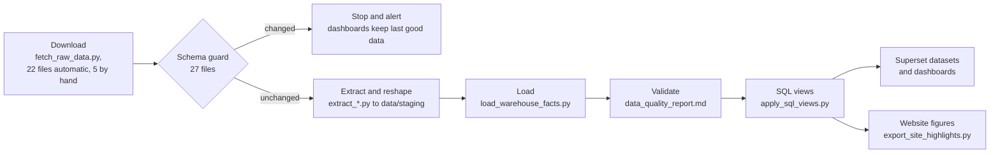

# Final Report — Draft of Sections 1-4

**Windsor Housing Visual Analytics** · COMP-8977 Internship/Project-2, Fall 2026
**Team 1:** Dhritiben Patel (Project Manager), Romit Patel (Data Engineering), Pavan Rella (Analytics), Charmiben Patel (Front-end and Deployment)
**Supervisor:** Dr. Andreas Maniatis · **Course Instructor:** Dr. Prashanth C. Ranga
**Status:** first merged draft, 19 November 2026. Sections 1-4 combine the introduction, background, methodology and pipeline material from `docs/design_document.md`, `docs/data_architecture.md`, `docs/decision_log.md` and `etl/README.md`, updated to the system as it runs today. Places that still need a citation or a team decision are marked **[TODO]**.

---

## 1. Introduction

### 1.1 Problem

Housing affordability in Windsor cannot be read from a single number. Whether a household is under pressure depends on how its **income** and **tenure** (renting or owning) meet the **rents** it faces, how easy it is to find a vacant unit, and whether **new housing** is being built fast enough to keep up. The data for each of these exists, but it is published by two agencies (Statistics Canada and the Canada Mortgage and Housing Corporation, CMHC), in different formats, at different geographies and for different years: the 2021 Census, CMHC's annual October rental survey, and monthly construction counts. A resident, journalist or planner who wants the whole picture has to find, download and reconcile these sources themselves.

### 1.2 Objective

The project builds a free, public, web-based tool that answers five questions about housing in the Windsor Census Metropolitan Area (CMA), each traced to its official source:

| Story | Question | Main sources |
|---|---|---|
| 1 | Who faces the greatest affordability pressure? | Census 2021, shelter cost by income and tenure (StatCan 98-10-0252-01) |
| 2 | What is happening in Windsor's rental market? | CMHC Rental Market Survey, Windsor, 2021-2025 |
| 3 | Is Windsor building enough housing? | CMHC starts and completions (StatCan 34-10-0154-01); CMHC intended-market tables |
| 4 | How does Windsor compare with similar markets? | CMHC Rental Market Survey, Canada, 2019-2025; StatCan 34-10-0133-01 and 34-10-0130-01; Census Profile 2021 |
| 5 | **Combined Analysis:** how do affordability, rental conditions and supply fit together? | Joins the sources above for Windsor and four comparison cities |

Story 5 exists because of supervisor feedback in November: the first four stories each rested on one person's dataset and read as four separate projects. Its questions (for example, *how many Windsor renters cannot afford the average 2-bedroom rent?* or *did construction keep up with population growth?*) can only be answered by joining datasets, which makes it the team's combined result.

### 1.3 Scope

| In scope | Out of scope |
|---|---|
| Windsor CMA, its 7 CMHC rental zones, 4 comparison CMAs (London, Hamilton, Kitchener-Cambridge-Waterloo, St. Catharines-Niagara), Toronto and, for one comparison, the 32 Canadian CMAs CMHC reports on | Other geographies below the zone level (postal codes, neighbourhoods) |
| Official open data only (Statistics Canada, CMHC) | Scraped listings (Kijiji, Facebook Marketplace) |
| Batch refresh when the agencies publish new files | Real-time data |
| Descriptive analytics, plus one clearly labelled scenario projection (Story 5, "Windsor 2030") | Price prediction, machine learning, chatbots |
| A public, read-only website and dashboards | User accounts, editing data from the website |

### 1.4 What was delivered

- A **data warehouse** (PostgreSQL, 17 tables and 59 SQL views) loaded by a Python pipeline from 27 source files, each checked against a saved snapshot of its structure before anything is loaded.
- **Six Apache Superset dashboards** (an overview and one per story), split into tabs that each fit one screen, with filters and cross-filtering.
- A **React website** that tells each story in plain language, shows the key findings as its own charts, and opens the matching dashboard.
- Deployment on the **University of Windsor's servers**: the data in the university's PostgreSQL database, the dashboards on its shared Superset (apss), and the website on the team's server (whva), with HTTPS, a firewall and daily backups.

### 1.5 Structure of this report

Section 2 gives the background: the data sources and the tools. Section 3 describes the method: how each story's question was turned into measures, and how data quality and consistency were checked. Section 4 describes the data pipeline from download to dashboard. **[TODO: sections 5 onward: results by story, website and dashboards, deployment, evaluation and user testing, limitations, conclusion.]**

---

## 2. Background

### 2.1 Housing affordability measures

The project uses the measures the two agencies themselves publish, so that its figures can be checked against theirs:

- **Shelter-cost-to-income ratio.** Statistics Canada counts a household as having an affordability problem when it spends **30% or more** of its total before-tax income on shelter (rent or mortgage, utilities, condominium fees, property taxes). Households with no income or a negative income have no ratio and are reported as "not applicable". **[TODO: cite the Census 2021 Dictionary entry.]**
- **Vacancy rate.** The share of purpose-built rental units that were vacant and available for rent in CMHC's October survey. Lower vacancy means a tighter market.
- **Average rent.** CMHC's average monthly rent of all surveyed units, occupied and vacant. CMHC also publishes the rent of vacant units separately, which is closer to what a new tenant pays.
- **Turnover rate.** The share of occupied units whose tenant changed in the previous 12 months.
- **Rental universe.** The number of purpose-built rental units (buildings with three or more units) in the survey.
- **Housing starts and completions.** CMHC's monthly count of new units whose construction began or finished, by dwelling type and, separately, by intended market (homeownership, rental, condominium, co-op).

### 2.2 Data sources and their limits

| Source | Publisher | Years | Geography | Used for |
|---|---|---|---|---|
| Shelter cost by income and tenure (98-10-0252-01) | Statistics Canada, Census 2021 | 2021 (incomes for 2020) | Windsor CMA | Story 1; Story 5 |
| Census Profile 2021 (98-401-X2021002) | Statistics Canada | 2016, 2021 | every CMA | population, households, renter burden; Stories 3-5 |
| Housing indicators by age (98-10-0241-01) | Statistics Canada | 2021 | 5 cities | young renters, Story 5 |
| Rental Market Survey, Windsor | CMHC | October 2020-2025 | 7 zones | Story 2 |
| Rental Market Survey, Canada | CMHC | October 2019-2025 | every major CMA | Stories 2, 4 and 5 |
| Rents and vacancy (34-10-0133-01, 34-10-0130-01) | CMHC, republished by StatCan | 2015 onward | every CMA | ten-year comparison, Story 4 |
| Starts and completions (34-10-0154-01) | CMHC, republished by StatCan | monthly from 2016 | Windsor CMA | Story 3 |
| Starts and completions by intended market | CMHC Housing Market Information Portal | 2023 onward | Windsor CMA | Story 3 |

Three properties of these sources shaped the design and are stated wherever they matter on the dashboards:

1. **Scope differs between tables.** CMHC publishes Windsor's figures both for apartments only and for apartments and row houses together, but the city comparison only for apartments. The same measure can therefore differ slightly (Windsor's October 2025 vacancy is 3.7% for apartments, 3.6% for both); every chart now names its scope (decisions D28, D56, D59).
2. **Figures are revised.** When CMHC moved to 2021 Census CMA boundaries in 2022, it revised the previous year: Windsor's October 2022 2-bedroom rent is $1,197 in the 2022 report and $1,174 in the 2023 report. The pipeline keeps the later, revised figure.
3. **Census counts are randomly rounded** to a multiple of 5, so parts do not always add to the published total. Rates use the published total as the denominator.

### 2.3 Tools

| Tool | Role | Why it was chosen |
|---|---|---|
| Python (pandas, openpyxl, SQLAlchemy) | extract, reshape, validate and load the source files | reads both StatCan CSVs and CMHC's formatted Excel workbooks |
| PostgreSQL | the data warehouse | the university provides it; SQL views keep every measure defined once |
| Apache Superset | interactive dashboards | open source, provided by the university (apss), connects directly to PostgreSQL |
| React (Vite) | the public website | full control over the story text, layout and the site's own charts |
| Docker Compose | the local development copy of PostgreSQL, Superset and Redis | the same stack on every team member's laptop |
| GitHub with Actions | version control, pull requests and automated tests | every change reviewed and tested before it reaches `main` |

**[TODO: one paragraph on related work, e.g. CMHC's own Housing Market Information Portal and municipal housing dashboards, and what this project adds (joining the sources and telling one story).]**

---

## 3. Methodology

### 3.1 From questions to measures

Each story started as a question from the project proposal, broken into sub-questions that a chart can answer, and each sub-question into a measure with a stated formula and source. The measures are defined once, as SQL views in `sql/story<n>_views.sql`, so the dashboards and the website show identical numbers (the website's figures are exported from the same views; decision D45). Key formulas:

- **Shelter-cost burden** = households spending 30% or more on shelter ÷ households with a shelter-cost ratio (the published total minus "not applicable"), by tenure, income group and household type.
- **Affordability gap** = renter burden − owner burden (23.8 points in 2021), and renter burden ÷ owner burden (3.18).
- **Income needed for a rent** = monthly rent × 12 ÷ 0.30, the income at which the rent is exactly 30% of income; the share of renters below it is counted from the Census income bands.
- **Starts per 1,000 households** = starts ÷ (2021 private households ÷ 1,000).
- **Homes needed for population growth** = (2021 population − 2016 population) ÷ people per household in 2021.
- **Rent index** = a city's rent ÷ its own 2019 (or 2015) rent × 100, so cities with different rent levels can be compared on growth.

### 3.2 Comparison design

Comparisons are kept like-for-like:

- **Comparison cities.** Windsor is compared with four Ontario CMAs of similar size and economy (London, Hamilton, Kitchener-Cambridge-Waterloo, St. Catharines-Niagara; justification in `docs/comparator_cmas_justification.md`), with Toronto added for the 2019-2025 rent and vacancy comparison and the 32 Canadian CMAs in CMHC's national report for the 2021 rent-versus-burden comparison.
- **Same scope and period on one chart.** A chart never mixes apartments-only and apartments-plus-row-houses figures, or two survey years, without saying so in its title or note.
- **Before and from the pandemic.** At the supervisor's request, Stories 3 and 4 compare the five years 2016-2020 (2015-2020 for rents) with the five years from 2020.
- **Year to date.** The current year is compared with the same months of earlier years, never with full years.

### 3.3 Combining the stories (Story 5)

Story 5's views join fact tables that were loaded separately for Stories 1-4, through shared dimensions (tenure, income band, period) and, for the comparison cities, the CMA code. Examples: renter incomes (Story 1) against rents (Story 2) give the share of renters who cannot afford a unit size; completions (Story 3) against vacancy (Story 2) show whether new supply eased the market; construction against population growth (Census) gives the share of needed homes that were built. The "Windsor 2030" tab projects, under clearly stated scenarios (each city's own past rent growth; renter incomes growing 2%, 3% or 4% a year), how many renters could be priced out of a 2-bedroom; it is presented as a range, not a forecast (decision D52).

### 3.4 Quality assurance

| Check | Where | What it catches |
|---|---|---|
| **Schema guard** | `etl/schema_guard.py`, before every refresh | a source file whose columns, sheets or header rows changed; nothing is loaded until it is resolved |
| **Extract checks** | each `extract_*.py` | missing cities, markets that do not add up to the total, unexpected layouts |
| **Load validation** | `etl/validate_rental_market_data.py`, after each load | row counts, value ranges, duplicate keys, CMHC reliability letters; written to `docs/data_quality_report.md` |
| **Validation against published figures** | Story 1 "Data Validation" tab | our computed renter and owner burden against the Census Profile's own figures (34.8% and 10.9%, difference 0.0) |
| **Cross-story consistency** | SQL checks run on 19 November 2026 | the same figure agrees wherever it appears: renter burden 34.8%, 2-bedroom apartment rent $1,454 and vacancy 3.7% (Oct 2025), 2025 starts 1,262, Jan-Sep 2026 starts 690 and completions 1,029 |
| **Automated tests** | 83 tests in `etl/test_*.py`, run by GitHub Actions on every merge | parsing, checks and refresh logic |
| **Dashboard checks** | browser automation | every tab loads without errors, fits one screen, and every filter works on every tab |
| **Reference screenshots** | the team's reference dashboards | colours, formats and values of Stories 1-4 match the agreed design |

### 3.5 Design principles for the dashboards and site

Each dashboard is split into tabs that fit one screen (supervisor feedback, decision D37); each tab answers one sub-question and ends with a short "What it shows" note whose numbers are read from the warehouse when the dashboard is built, so they cannot drift from the charts. The website tells the story first and links to the dashboards for exploration (decision D54). **[TODO: user-testing method and results, once the sessions are done.]**

---

## 4. Data Pipeline

### 4.1 Overview

### 4.2 Stages

1. **Acquire.** `etl/fetch_raw_data.py` downloads the 22 files that can be downloaded by a script (StatCan tables, CMHC rental workbooks) into `data/raw/`, unchanged. Five files must be saved by hand: the Census Profile (its site refuses scripted downloads), CMHC's quarterly workbook (renamed each quarter), and three exports from CMHC's Housing Market Information Portal. `etl/README.md` lists them and how often to refresh them.
2. **Guard.** `etl/schema_guard.py` compares every file's columns, sheets and header rows with the snapshot in `etl/configs/source_schemas.json`. Any difference stops the run before anything is read.
3. **Extract and reshape.** One script per source (`extract_*.py`) reads the file and writes a tidy, long-format CSV to `data/staging/`: one row per measure, place, category and period. Agency symbols are handled explicitly (for example CMHC's `**` for a suppressed value becomes empty, `-` for nil becomes 0).
4. **Load.** `etl/load_warehouse_facts.py` loads the staging files into the `warehouse` schema: shared dimensions (period, zone, tenure, income band, bedroom type, dwelling type) and one fact table per source family.
5. **Validate.** The rental data is re-checked after loading and the results are written to `docs/data_quality_report.md`.
6. **Model.** `etl/apply_sql_views.py` (re)creates the 59 views, one file per story.
7. **Publish.** `etl/register_superset_datasets.py` registers the views in Superset, and one builder script per dashboard (`etl/build_story<n>_dashboard.py`) creates or updates its charts, tabs, filters, colours and notes. The same scripts build on the local Superset and on the university's (`build_all_dashboards.py --env .env.apss`). `etl/export_site_highlights.py` writes the website's figures from the same views.

### 4.3 Warehouse

The warehouse is a star schema: shared dimensions and the fact tables below. Full column definitions are in `docs/data_dictionary.md`.

| Fact table | Grain | Rows | Stories |
|---|---|---|---|
| `fact_shelter_cost` | income band × tenure × household type × shelter-cost category, 2021 | 90,720 | 1, 5 |
| `fact_rental_market` | zone × unit size × survey × dwelling scope × measure | 2,655 | 2, 5 |
| `fact_windsor_starts_completions` | month × activity × dwelling type, from January 2016 | 1,935 | 3, 5 |
| `fact_starts_completions` | province (Ontario, Canada) × quarter × activity × dwelling type | 50 | Overview |
| `fact_census_profile` | Census characteristic × geography | 360 | 3, 5 |
| `fact_rental_market_comparison` | comparison city × measure × survey | 36 | 4 |
| `fact_peer_cma_context` | city × source × measure × category × year | 1,273 | 4, 5 |
| `fact_cma_canada` | Canadian CMA × measure × year | 1,008 | 2, 4 |
| `fact_windsor_intended_market` | period × activity × intended market | 29 | 3 |

### 4.4 Refresh and operations

`etl/scheduled_refresh.py` runs the whole pipeline weekly: it downloads the tables that change monthly or yearly, runs the schema guard, then the extracts, the load and the views. Any failure stops the run, writes an alert to `logs/refresh_alerts.log` and, if configured, posts it to a Teams or Slack webhook; the dashboards keep the last good data. On the university side, the team's `warehouse` schema is backed up daily from whva (14 days kept, each backup checked with `pg_restore --list`), and the data is moved to the university database as one SQL package (`etl/export_for_shared_db.py`) loaded in a single transaction, so a failed load changes nothing.

An uptime check runs on whva every 5 minutes and alerts once per outage; the nightly backup was restored into a fresh database on 20 November with every table and view intact (section 7.3). **[TODO: live refresh result.]**
