# Final Findings

**Windsor Housing Visual Analytics** · COMP-8977 Internship/Project-2, Fall 2026
**For:** section 5 of the final report. Figures are exported from the project's dashboards (`docs/figures/`, 2x resolution); every number is read from the warehouse views as of 19 November 2026 (data to October 2025 for rents, September 2026 for construction). Scope is stated where it matters: *apartments* means CMHC's apartment-only tables; *apartments and row houses* its combined tables.

---

## Summary

| Story | Question | Finding |
|---|---|---|
| 1 | Who faces the greatest affordability pressure? | **Renters**, and above all low-income renters: 34.8% of renter households spend 30% or more of income on shelter, against 10.9% of owners. |
| 2 | What is happening in Windsor's rental market? | Vacancy has recovered (1.8% in 2022, 3.7% in 2025) but rents kept rising (2-bedroom apartment +53% since 2019), and the cheapest units are the hardest to find. |
| 3 | Is Windsor building enough housing? | Building rose to a peak in 2024 and is now falling; this year's starts are 21% behind the same months of 2025. |
| 4 | How does Windsor compare with similar markets? | Still the cheapest of the five Ontario cities, but its rents have risen fastest since 2019. |
| 5 | Combined Analysis | Windsor is **cheaper, not more affordable**: 61% of its renters cannot afford the average 2-bedroom, it built the fewest homes for its growth, and on current trends the share priced out rises. |

---

## Story 1 — Who faces the greatest affordability pressure?

**Answer: renters, and the lower their income the greater the pressure.** In the 2021 Census (incomes for 2020), **34.8%** of Windsor's renter households spent 30% or more of income on shelter, against **10.9%** of owners: a gap of **23.8 percentage points**, or **3.18 times**. Our computed rates match Statistics Canada's published figures exactly (difference 0.0 points).

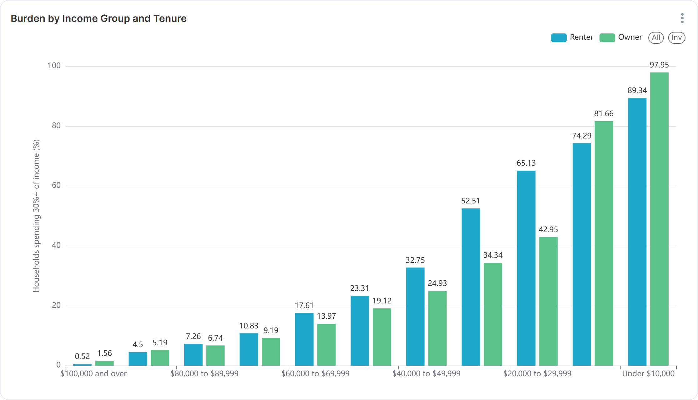
*Figure 1. Share of households spending 30%+ of income on shelter, by 2020 household income and tenure. Statistics Canada 98-10-0252-01.*

- Burden falls steeply with income. Below $10,000, **89.3%** of renters and **97.9%** of owners are over the line; from $100,000, under 2% of either.
- In the middle income bands ($20,000 to $89,999) renters are more burdened than owners at the same income, by up to 22 points ($20,000-$29,999: 65.1% against 43.0%). Owners are more burdened under $20,000 (by 7-9 points) and, by about a point, from $90,000.
- Non-family households (mostly people living alone) are the most burdened: **43.2%** of non-family renters, against **25.8%** of family renters.

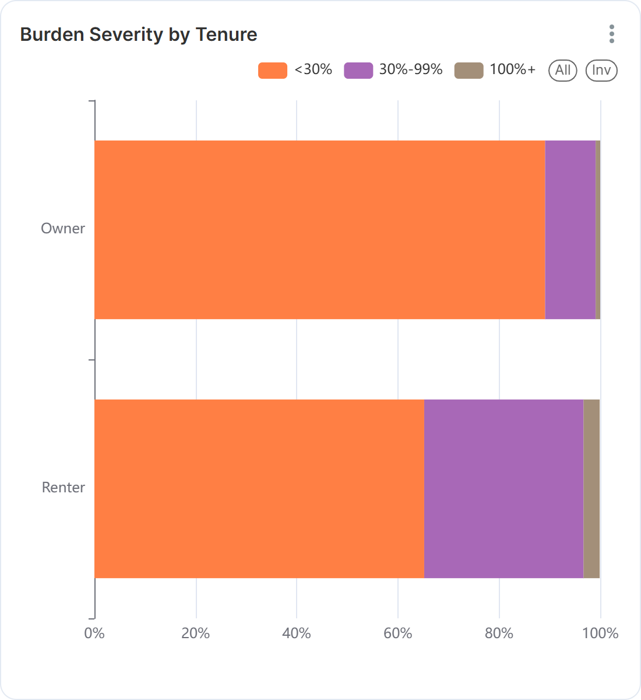
*Figure 2. Every renter and owner household by share of income spent on shelter.*

- **3.2%** of renter households spend **100% or more** of their income on shelter, three and a half times the owner rate (0.9%), and 31.5% spend between 30% and 100%.

**What it means:** affordability in Windsor is first a renters' problem, concentrated in households with low incomes and in single-person households. Policies aimed at ownership would miss most of the households under pressure.

## Story 2 — What is happening in Windsor's rental market?

**Answer: renting has become easier to find but not cheaper.**

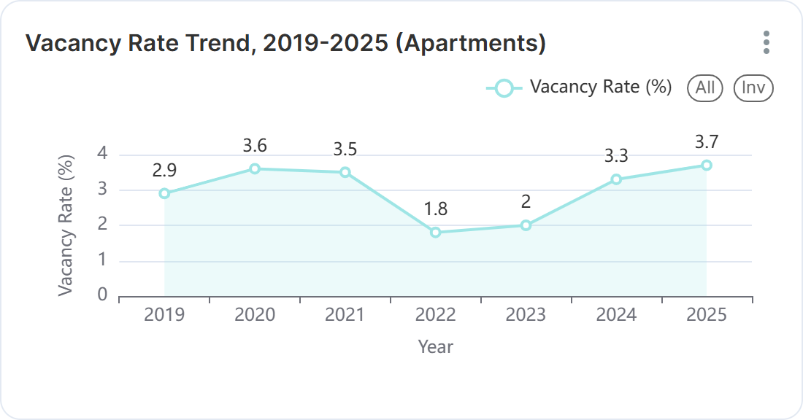
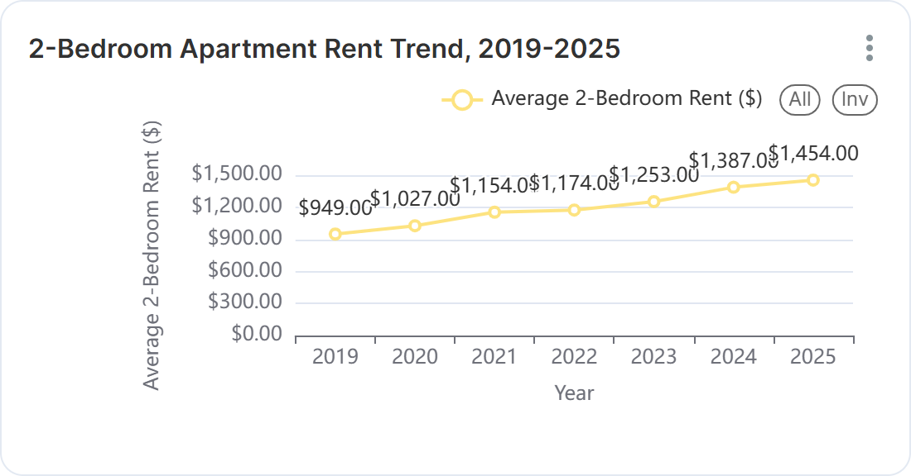
*Figures 3-4. Windsor's October apartment vacancy rate and 2-bedroom apartment rent, 2019-2025. CMHC Rental Market Survey, Canada, Table 1.0 (2022 as revised).*

- Apartment vacancy fell to **1.8%** in 2022, a very tight market, and recovered to **3.7%** by 2025.
- The 2-bedroom apartment rent rose every year regardless: **$949** in 2019 to **$1,454** in 2025 (**+53%**). Rising vacancy has slowed rent growth (+5.4% in 2024, +3.6% in 2025) but not reversed it.
- New tenants pay more than sitting ones: a vacant 2-bedroom rented for **$1,643** in October 2025 against **$1,447** for an occupied one.

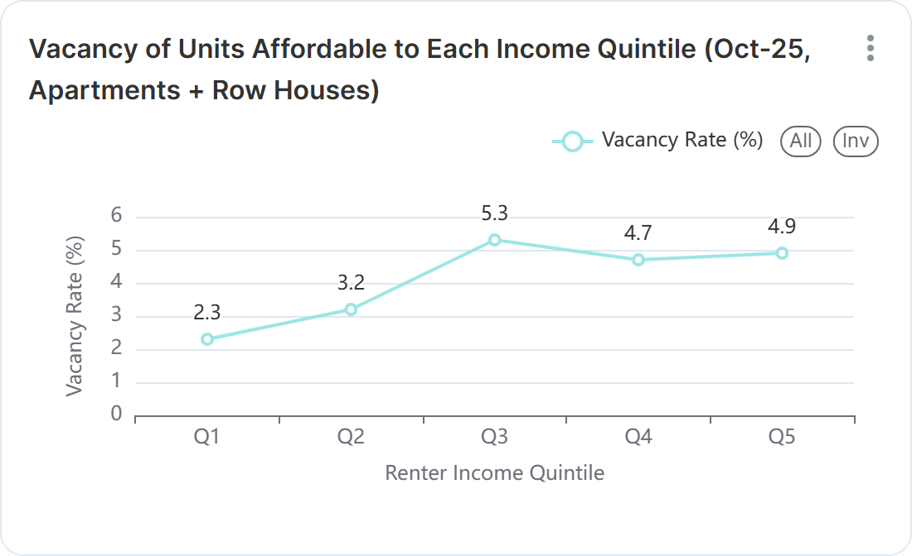
*Figure 5. Vacancy rate among the rental units each renter income quintile can afford (rent at most 30% of the quintile's upper income), October 2025. CMHC Table 3.1.8, apartments and row houses.*

- The lowest-income fifth of renters (Q1) can afford only **22.5%** of Windsor's rental units, and those are the hardest to find: **2.3%** vacant, against **5.3%** for the units Q3 renters can afford.

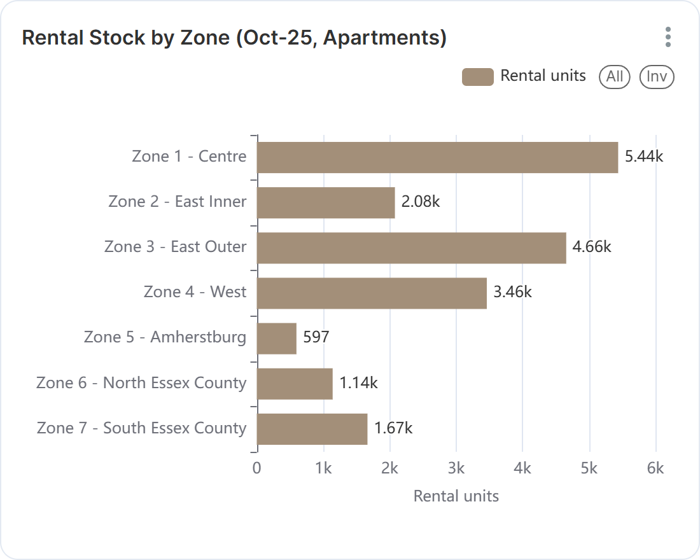
*Figure 6. Purpose-built apartment units by CMHC zone, October 2025.*

- Rents differ by $798 a month between zones: **$1,157** in Zone 1 (Centre), which also has the most units (5,439) and the highest vacancy (4.7%), and **$1,955** in Zone 5 (Amherstburg).

**What it means:** the 2022 squeeze has eased, but rents did not come back down, and the cheapest units remain scarce: the market's recovery helps renters who can pay more, less so those with the lowest incomes.

## Story 3 — Is Windsor building enough housing?

**Answer: construction peaked in 2024 and is slowing, while the mix has shifted to apartments and to rental.**

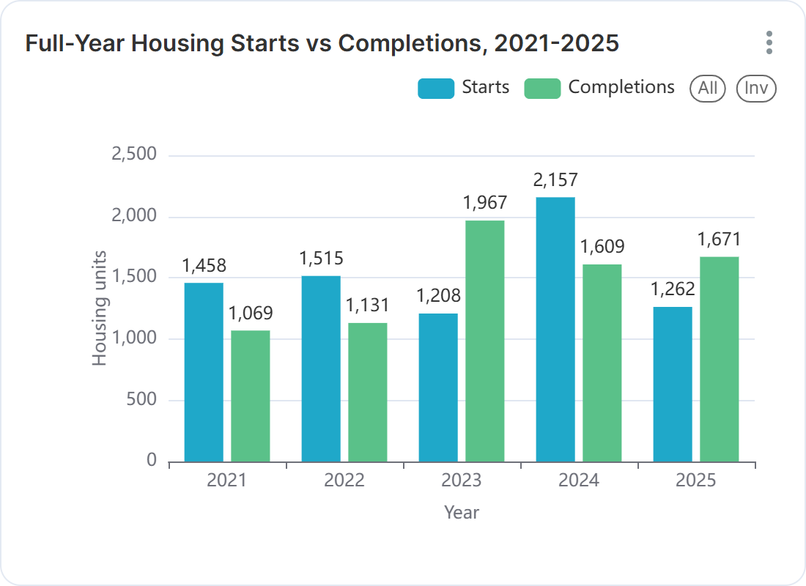
*Figure 7. Windsor CMA housing starts and completions, 2021-2025. CMHC via Statistics Canada 34-10-0154-01.*

- Starts peaked at **2,157** in 2024 and fell to **1,262** in 2025; completions reached **1,967** in 2023 as the earlier starts finished.

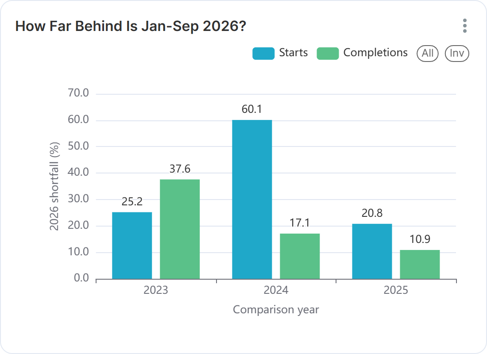
*Figure 8. How far starts and completions from January to September 2026 are below the same months of earlier years.*

- From January to September 2026, Windsor started **690** homes and completed **1,029**: starts are **21%** behind the same months of 2025 and **60%** behind 2024.

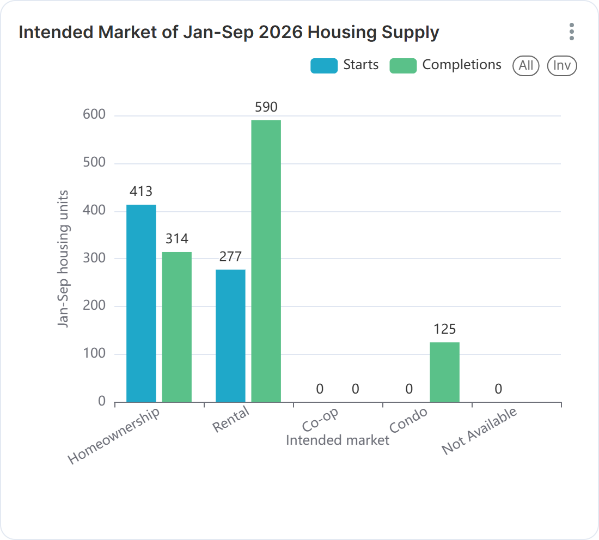
*Figure 9. Starts and completions by the market they are built for, January-September 2026. CMHC Housing Market Information Portal.*

- Rental completions dominate this year (**590**, 57% of completions), the result of the apartment wave started in 2023-2024; but only **277** rental homes were started, against **413** for homeownership.
- Multi-unit buildings (anything but single-detached houses) were **77.5%** of this year's completions, up from 47.4% in the same months of 2021.

**What it means:** the rental supply now arriving was started two to three years ago; with starts falling, and rental starts in particular, that supply will thin out from 2027. Combined with Story 5, Windsor did not build enough for its 2016-2021 growth.

## Story 4 — How does Windsor compare with similar markets?

**Answer: Windsor is still the cheapest of the five Ontario cities, but the gap is closing fastest.**

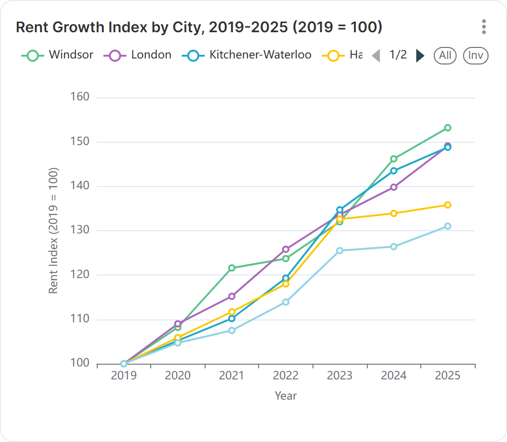
*Figure 10. October 2-bedroom apartment rent as % of each city's own 2019 rent. CMHC Rental Market Survey, Canada (2022 as revised).*

- In October 2025 Windsor's 2-bedroom apartment rent (**$1,454**) was the lowest of the five cities (St. Catharines $1,527, London $1,651, Hamilton $1,656, Kitchener-Cambridge-Waterloo $1,832).
- But since 2019 it rose **53%**, more than London (49%), Kitchener-Waterloo (49%), Hamilton (36%) or Toronto (31%).
- Vacancy followed the same path everywhere: lowest between 2021 and 2023, higher again by 2025 (Windsor 3.7%, within the five cities' range of 3.6% to 4.1%).

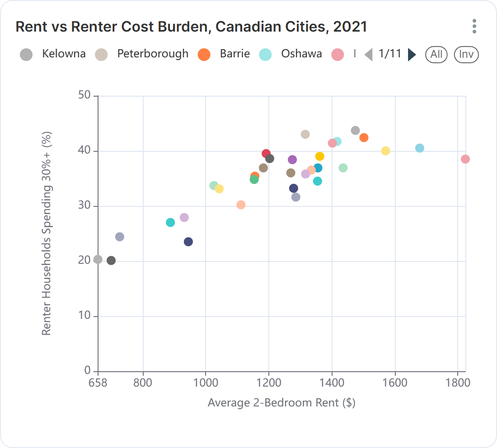
*Figure 11. October 2021 2-bedroom apartment rent against the share of renters spending 30%+ on shelter (Census 2021), 32 Canadian CMAs.*

- Across 32 Canadian cities in 2021, renters were more likely to be over the 30% line where rents were higher. Windsor was cheaper than 22 of the other 31 and had a lower renter burden than 19.

**What it means:** Windsor's advantage as a cheap market is shrinking quickly; on the 2019-2025 trend, its rents are converging on those of its neighbours.

## Story 5 — Combined Analysis

**Answer: cheaper is not the same as affordable.** Story 5 joins the other stories' data, which none of them could answer alone.

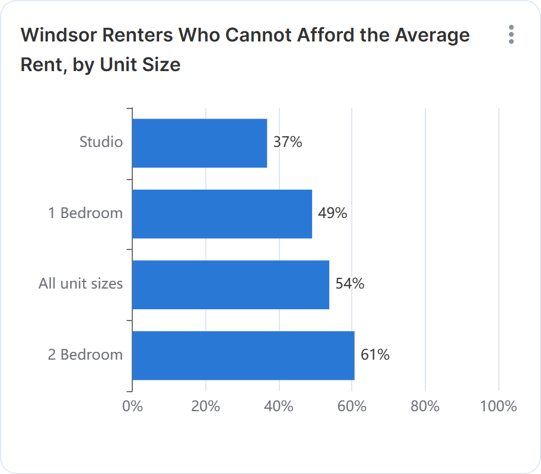
*Figure 12. Share of Windsor renter households whose income is below what the average rent requires (rent at 30% of income). Census 2021 renter incomes (Story 1) against CMHC October 2025 rents (Story 2), apartments and row houses.*

- The average 2-bedroom ($1,451) needs an income of about **$58,000**; **60.7%** of Windsor's renter households have less. Even the average studio is out of reach for 36.8%.
- Windsor's 2-bedroom rent takes **36%** of the median renter's income ($48,400), the same share as Hamilton's and close to the other cities' (36%-39%): Windsor's lower rents are matched by lower renter incomes.

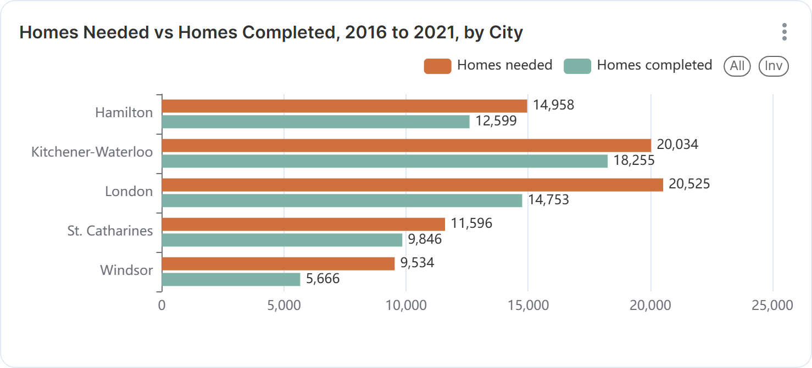
*Figure 13. Homes needed for 2016-2021 population growth (growth divided by 2021 household size) against homes completed, five cities.*

- Windsor completed **5,666** homes against about **9,534** needed for its population growth: **59%**, the lowest of the five cities (London 72%, Hamilton 84%, St. Catharines 85%, Kitchener-Waterloo 91%). It also starts the fewest homes for its size (8.4 per 1,000 households a year).
- Young renters (household maintainer aged 15-24) are the most burdened age group in Windsor (**46.5%** over the 30% line), though less than in the other four cities (50.6%-55.3%).

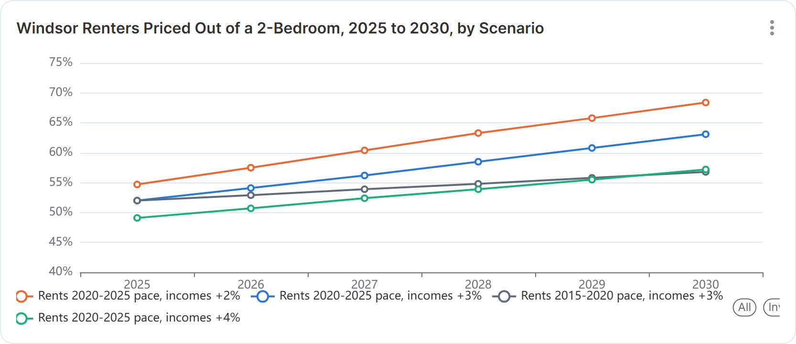
*Figure 14. Projected share of Windsor renter households who could not afford the average 2-bedroom, 2025-2030, under four scenarios (rent growth at Windsor's own 2015-2020 or 2020-2025 pace; renter incomes +2%, +3% or +4% a year). Scenarios, not forecasts.*

- In the central scenario (2020-2025 rent pace, incomes +3% a year), the share priced out of a 2-bedroom rises from **52%** to **63%** by 2030. It rises in every one of the six scenarios; the 2030 share ranges from 51% (slower 2015-2020 rent pace and incomes +4% a year) to 68% (2020-2025 pace, incomes +2%). The chart shows four of the six.

**What it means:** Windsor's lower rents do not make it more affordable for its renters, its construction did not keep up with its growth, and the recent rent trend outpaces any plausible income growth. The pressure identified in Story 1 is likely to grow unless rent growth slows or more rental housing is built.
