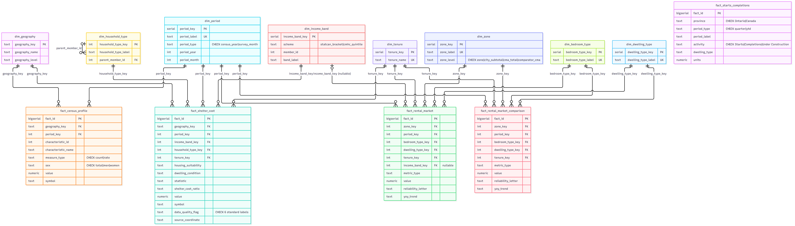

# Warehouse ER Diagram

The conformed-dimension star schema in `sql/warehouse_schema.sql`: 8 dimension tables + 5 fact
tables (one per profiled source), with every primary key, foreign key, unique constraint and CHECK
constraint the DDL actually enforces shown directly on the diagram — not a separate description
that could drift from the real schema.



**Source:** `docs/diagrams/warehouse_er_diagram.mmd` (Mermaid `erDiagram` syntax), rendered to PNG
via `mermaid-cli` for direct embedding in the report:

```
npx -p @mermaid-js/mermaid-cli mmdc -i docs/diagrams/warehouse_er_diagram.mmd -o docs/diagrams/warehouse_er_diagram.png -b white --size 3000 -s 2
```

Re-run that command and commit the new PNG whenever `sql/warehouse_schema.sql` changes, so the
diagram never drifts from the real DDL.

## Reading the diagram

- **PK** = primary key, **FK** = foreign key, **UK** = unique constraint (shown as a note column on
  the same row as the constrained field, since Mermaid's `erDiagram` syntax has no separate marker
  for a column-level `CHECK` — those are written out as `"CHECK ..."` notes instead).
- A crow's-foot line from a dimension to a fact table means that fact table has a `NOT NULL`
  foreign key into that dimension, except the one line explicitly labeled `(nullable)`:
  `dim_income_band` → `fact_rental_market`, which is `NULL` for every row except the Table 3.1.8
  income-quintile rows (see the comment in `sql/warehouse_schema.sql`).
- `fact_starts_completions` has no lines to any dimension — by design, not an omission. Its
  `province` and `dwelling_type` columns are deliberately local text, not foreign keys, because
  this source's geography and dwelling-type classification don't share a grain with any of the
  other sources' dimensions (full reasoning in the DDL's own comment on that table).
- `dim_household_type` has a self-referencing line (`parent_member_id`) for its 16-member
  hierarchy, not a relationship to another table.

## What the DDL enforces beyond what's visible on the diagram

- **Every fact table has a `UNIQUE` constraint on its full documented grain** (the column
  combination that should appear at most once per row), catching an accidental duplicate load —
  verified against the real, currently-loaded data (93,551 rows across all 5 fact tables) with
  zero violations before these constraints were added.
- **Every foreign-key column on every fact table has its own index** (18 total) — Postgres indexes
  a foreign key's *referenced* side automatically via that column's primary key, but never the
  *referencing* (fact-table) side, so without these, filtering or joining from a fact table back to
  one dimension would be a full table scan.
- `fact_rental_market` and `fact_rental_market_comparison` are two separate tables, not one, even
  though they share the same CMHC RMS metric vocabulary and dimension FKs: they come from two
  separate source workbooks (Windsor RMS 2025 vs. Canada RMS 2025), and this schema's rule is one
  fact table per source (see the comment on `fact_rental_market_comparison` in
  `sql/warehouse_schema.sql`).
- `fact_rental_market.metric_type` and `fact_rental_market_comparison.metric_type` are deliberately
  **not** `CHECK`-constrained, unlike this schema's other categorical columns — genuinely
  open-ended (only 12 of the CMHC RMS workbook's 29 sheets are extracted so far; see
  `docs/cmhc_rms_sheet_catalogue.md`), so a fixed list would need editing on every future extraction
  rather than actually catching bad data.
